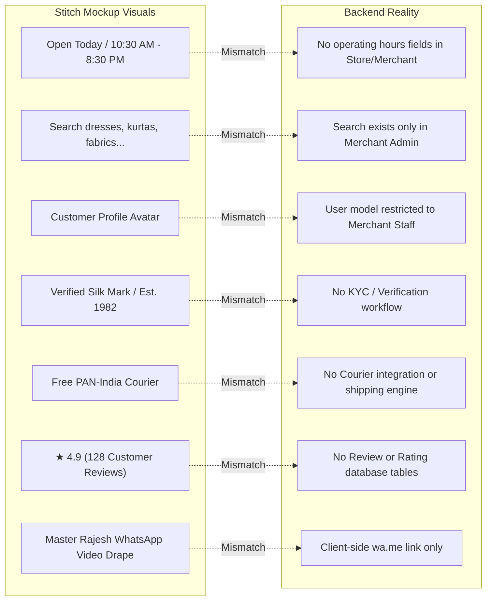

# Stage C: Storefront Backend Gap Analysis, Reconciliation & Technical Remediation Plan

**Document:** `docs/architecture/STAGE_C_BACKEND_GAPS_AND_REMEDIATION_PLAN.md`  
**System:** MyCatalogue Digital Storefront SaaS  
**Scope:** Stage C Customer-Facing Storefront vs. Existing Multi-Tenant Backend  
**Design Reference:** Stitch Project `6403466717281225322` (Screens 1 to 6)  
**Status:** Architecture Review & Engineering Reconciliation (Inspection & Planning Only)  

---

## 1. Executive Summary & Purpose

This document reconciles the visual direction established in the Stitch storefront designs (`8d0d0950bef0456f81dad65408e58685` through `8fe5e14e7c9b4e7193b502725ad47e50`) with the actual, verified codebase of MyCatalogue.

Following the initial implementation of Stage C1 (Foundation) and Stage C2 (Public Store Homepage), several frontend elements and Stitch mockups introduce promises (operating hours, customer profiles, instant search, customer reviews, free courier shipping, verified trust badges) that have **varying degrees of backend support**.

The objective of this report is to:
1. Conduct an evidence-based audit of every capability across models, selectors, forms, views, templates, and tests.
2. Formally classify each feature using standardized completion statuses.
3. Critically evaluate 9 proposed architecture changes against strict multi-tenant safeguards, privacy rules, and code complexity constraints.
4. Establish an unambiguous implementation sequence dividing work strictly into **Current MVP (C2, C3, C4)**, **Post-MVP Merchandising**, and **Future Platform Capabilities**.

---

## 2. Verified Current Implementation Matrix

Every feature below has been directly verified by inspecting the application models, selectors, services, forms, management views, templates, URLs, and automated test suites.

### Standardized Status Definitions:
- **Complete**: Fully backed by database models, business logic, merchant dashboard, public views, and automated tests.
- **Partially implemented**: Core backend or base query exists, but public views, parameters, or templates are incomplete.
- **Frontend only**: Present in templates or Stitch mockups as visual placeholders with no real backend data backing.
- **Backend only**: Backed by models/services/forms, but not yet integrated or exposed on the public storefront.
- **Not implemented**: Completely absent from both frontend templates and backend code.
- **Deferred**: Explicitly excluded from MVP scope to prevent fabricated claims or premature complexity.

---

### Implementation Verification Table

| # | Feature / Capability | Database Support | Backend Business Logic | Merchant Dashboard Support | Public Storefront Support | Automated Tests Available | Verified Status |
| :---: | :--- | :--- | :--- | :--- | :--- | :--- | :---: |
| **1** | **Public Store Homepage (`/s/<slug>/`)** | `Store`, `Merchant`, `Product`, `Category` models exist. | `get_public_store_by_slug` (`apps/stores/selectors.py:10-33`), `is_publicly_accessible` invariant, owner membership resolution (`apps/stores/views.py:35-42`). | `StoreSettingsView` (`apps/stores/views_management.py:54-100`), slug management, publish toggle. | `templates/stores/public_detail.html` rendering Hero, Categories, Latest Products, Story. | `apps/stores/tests/test_storefront_homepage_c2.py` (8 passed), `test_public_store_access.py` (11 passed). | **Complete** |
| **2** | **Storefront Header & Navigation** | `Store.logo`, `Store.name`, `Category.name`, `Category.slug`. | Active category retrieval (`apps/products/selectors.py:56-71`). | Category management (`apps/products/views.py`), Store profile form. | `templates/storefront/partials/_header.html` with responsive brand identity & category sub-nav. | `apps/stores/tests/test_storefront_foundation_c1.py` (7 passed), `test_storefront_homepage_c2.py`. | **Complete** |
| **3** | **Storefront Footer & Legal Attribution** | `Store.name`, `Store.description`, `Merchant.city`, `Merchant.state`, `Store.social_links`. | Social links validation (`apps/stores/validators.py:16-56`), safe location disclosure. | Social link inputs in `StoreProfileForm` (`apps/stores/forms.py:347-394`). | `templates/storefront/partials/_footer.html` with platform attribution and verified social icons. | `apps/stores/tests/test_storefront_foundation_c1.py` (7 passed). | **Complete** |
| **4** | **Public Product Catalog Listing (`/s/<slug>/products/`)** | `Product`, `Category`, `ProductImage` models. | Base selector `get_public_storefront_products` (`apps/products/selectors.py:167-229`). Lacks `q`, `availability`, and price sorting. | Full product CRUD, publish/unpublish, image upload (`apps/products/views.py`). | Route `/s/<slug>/products/` not wired. Template `templates/products/public_list.html` not created. | Selector tests in `apps/products/tests/test_public_visibility.py`. No public list view test. | **Partially implemented** |
| **5** | **Public Storefront Search** | `Product.name`, `Product.sku` DB-indexed. | Search query filter exists in merchant admin (`apps/products/selectors.py:112-116`), but missing from public selector. | Supported on merchant product catalog list. | Disabled visual placeholder input in `_header.html` (`aria-label="Search catalogue"`). | Tested in merchant admin only (`apps/products/tests/test_views.py`). | **Frontend only** (on storefront) |
| **6** | **Public Product Detail View (`/s/<slug>/p/<product-slug>/`)** | `Product`, `ProductImage`, `ProductCategory`. | No public slug-based single product selector exists in `apps/products/selectors.py`. | Product edit view and gallery management (`apps/products/views.py`). | Route and template not created (`templates/products/public_detail.html` does not exist). | None for public product detail. | **Not implemented** |
| **7** | **Related Products Recommendation** | `ProductCategory` through-model. | No related products selector exists in `apps/products/selectors.py`. | Not applicable. | Not implemented. | None. | **Not implemented** |
| **8** | **WhatsApp Click-to-Enquire** | `Store.whatsapp_number`, `Store.allow_whatsapp_fallback`, `Merchant.contact_number`. | No E.164 normalization function or WhatsApp inquiry URL generator exists. | Form inputs in `StoreCreationForm` and `StoreProfileForm` (`apps/stores/forms.py:153-175`). | Call link (`tel:`) present; WhatsApp action not yet integrated. | Model/form tests in `test_store_settings_stage_b.py`. | **Backend only** |
| **9** | **Store Operating Hours & "Open Today" Badge** | None. Neither `Store` nor `Merchant` has operating hours fields. | None. No business hours evaluation logic. | None. No form fields or settings in merchant dashboard. | Hardcoded `"10:00 AM – 8:30 PM"` and `"Open Today"` displayed in hero card. | Test asserts static string presence in `test_storefront_homepage_c2.py`. | **Frontend only** |
| **10** | **Customer Account / Profile Button** | None for consumers. Only merchant staff `User` and `MerchantMembership` exist. | None. | Not applicable. | Avatar button rendered in `_header.html` (`aria-label="Customer Profile"`). | Test asserts button presence in `test_storefront_homepage_c2.py`. | **Frontend only** |
| **11** | **Curated "Featured Products"** | None. `Product` has no `is_featured` boolean or display order field. | None. | None. | Section on homepage re-scoped to "Latest Products" ordered by `-created_at`. | Asserted as "Latest Products" in `test_storefront_homepage_c2.py`. | **Deferred** (Re-scoped to Latest Products) |
| **12** | **Verified Store & Trust Badges** | None. Only `Merchant.status == ACTIVE` exists. | None. | None. | Explicitly removed from UI per project constraints. | Tests assert `"Verified Store" not in content` in `test_storefront_homepage_c2.py`. | **Deferred** |
| **13** | **Customer Reviews & Ratings** | None. | None. | None. | Explicitly excluded. | None. | **Deferred** |
| **14** | **Free Shipping & Delivery Promises** | None. | None. | None. | Explicitly excluded. | None. | **Deferred** |
| **15** | **Return & Exchange Policy Terms** | None. | None. | None. | Explicitly excluded. | None. | **Deferred** |
| **16** | **Storefront Inquiry / Lead Tracking** | None. | None. | None. | Direct `tel:` links; no click tracking. | None. | **Deferred** |

---

## 3. Frontend / Backend Mismatch Matrix (Stitch vs. Reality)

The following matrix documents the specific discrepancies between what Stitch mockups depict and what the backend actually supports:



### In-Depth Discrepancy Breakdown

1. **Operating Hours & Live Status (`Open Today`)**:
   - *Stitch Screens 2 & 6*: Display retail hours and a green "Open Today" pill.
   - *Backend*: Neither `Store` nor `Merchant` has fields for opening/closing times, days of operation, or lunch/break hours.
   - *Architectural Conflict*: Presenting static hours as live store status misleads shoppers when a store is closed, operates different hours, or observes regional holidays.

2. **Central Search Bar**:
   - *Stitch Screens 5 & 6*: Prominent search input in header.
   - *Backend*: Substring search (`Q(name__icontains=q) | Q(sku__icontains=q)`) is implemented in `apps/products/selectors.py:112` for merchant admin views, but the public storefront selector `get_public_storefront_products` (`apps/products/selectors.py:167`) completely lacks search parameter handling.
   - *Current State*: Rendered as a disabled visual placeholder in `templates/storefront/partials/_header.html`.

3. **Customer Profile Button**:
   - *Stitch Screens 2 & 6*: Circular avatar icon in the top right header.
   - *Backend*: `apps.users.models.User` exists solely for merchant owners and staff linked via `MerchantMembership`. There is no consumer/shopper account model, no customer registration, and no order history.
   - *Current State*: Rendered as a placeholder button in `_header.html`.

4. **Trust & Verification Claims**:
   - *Stitch Screen 6*: Displays "Verified Silk Mark", "Est. 1982 Katra Neel", and "Direct Artisan Sourcing".
   - *Backend*: The platform has no verification workflow, no KYC, no GSTIN validation, and no Silk Mark certification authority. Only `MerchantStatus.ACTIVE` exists.
   - *Resolution*: All unverified badges were rejected in Stage C1 and C2.

5. **Shipping & Courier Guarantees**:
   - *Stitch Screens 1 & 3*: "Free PAN-India Courier", "Dispatches in 24 Hours", "Delivered in 2-3 Days".
   - *Backend*: No courier API integration (e.g., Shiprocket, Delhivery), no shipping rate tables, and no pin-code serviceability checks.
   - *Resolution*: Excluded from public templates.

6. **Customer Ratings & Social Proof**:
   - *Stitch Screens 1, 3, & 5*: "★ 4.9 (128 verified customer reviews)".
   - *Backend*: No `ProductReview` model exists.
   - *Resolution*: Excluded to prevent fabricated social proof.

7. **Video Drape & Response Times**:
   - *Stitch Screens 1 & 3*: "Want a Live Video Drape? Master Rajesh shows borders over WhatsApp video call", "Responds in ~15 mins".
   - *Backend*: WhatsApp integration is purely a client-side `wa.me` URL redirect. There is no automated video calling or response-time tracking.

---

## 4. Evaluation of Proposed Architecture Changes

We critically review the 9 proposed architectural modifications to identify incorrect assumptions, missing validations, unnecessary complexity, and tenant-isolation risks.

### Proposal 1: Structured Weekly Store Operating Hours
- **Previous Proposal**: Store a full weekly JSON schedule (`{'mon': {'open': '10:00', 'close': '20:30', 'closed': False}, ...}`) in `Store.operating_hours`.
- **Critical Evaluation**:
  - *Incorrect Assumption*: Assumes independent Indian retailers need complex day-by-day scheduling. Most independent retail boutiques operate fixed standard hours with one designated weekly off-day (e.g., "Closed Tuesdays" in Delhi/Varanasi textile markets).
  - *Unnecessary Complexity*: A weekly JSONField requires custom nested JSON validation in forms, complex timezone conversions, and extensive UI controls in `StoreSettingsView`.
  - *Missing Validation*: Weekly JSON structures easily fail on corrupt day keys, missing sub-keys, malformed 24-hour time strings (`25:00`), or overnight shifts crossing midnight.
  - *Safeguard Violation*: Showing static hours when no database field exists violates our rule against presenting unverified claims.
- **Corrected Recommendation**:
  - **Defer operating hours schema changes for the MVP.**
  - **Template Safeguard**: In `templates/stores/public_detail.html`, conditionally display the operating hours row only when merchant hours exist. Until real fields exist, remove the static `"10:00 AM – 8:30 PM"` and `"Open Today"` strings to eliminate the mismatch, or label them explicitly as default showroom hours if mandated by the client.

### Proposal 2: Public Product Search & Filtering
- **Previous Proposal**: Add `search_query`, `category_slug`, `availability_mode`, and `ordering` to `get_public_storefront_products()`.
- **Critical Evaluation**:
  - *Soundness*: Essential for Stage C3 (`/s/<store-slug>/products/`).
  - *Tenant Isolation*: Must strictly enforce `merchant=store.merchant` on both products and category lookups.
  - *Ordering Whitelist Safeguard*: Passing arbitrary strings directly to `.order_by()` is a critical security vulnerability. Must use an explicit dictionary whitelist mapping client keys to ORM expressions.
  - *Price Privacy Safeguard*: Products with `price_display_mode == CONTACT_FOR_PRICE` must not leak numeric prices via sorting rank. In the ordering logic, items with `CONTACT_FOR_PRICE` must sort with null prices (`nulls_last=True`).
  - *Search Sanitization*: Search strings must be trimmed, limited to 100 characters, and escaped to prevent excessive query cost.

### Proposal 3: Public Product Detail Selector
- **Previous Proposal**: Create `get_public_product_by_slug(store: Store, product_slug: str) -> Product | None`.
- **Critical Evaluation**:
  - *Soundness*: Required for Stage C4 (`/s/<store-slug>/p/<product-slug>/`).
  - *Slug Collision Safety*: In `apps/products/models.py`, `Product` enforces `UniqueConstraint("merchant", Lower("slug"))`. Therefore, `(store.merchant, slug)` is guaranteed unique.
  - *Publication Invariant*: Must verify `store.is_publicly_accessible()` and `merchant.status == ACTIVE`. If store is unpublished, return `None` (resulting in `Http404`).
  - *Performance*: Must prefetch all `ProductImage` objects (ordered by `display_order, created_at`) and active `Category` objects to prevent N+1 queries.

### Proposal 4: Related Products Selector
- **Previous Proposal**: `get_public_related_products(product: Product, limit: int = 4) -> QuerySet[Product]`.
- **Critical Evaluation**:
  - *Soundness*: Needed for Stage C4 product detail recommendations.
  - *Tenant Isolation*: Query must be strictly constrained to `merchant=product.merchant` and `status=ProductStatus.PUBLISHED`.
  - *Edge Case Handling*: If a product has no categories assigned, the selector must not return an empty set; it should fall back to the merchant's latest published products (excluding the current product).
  - *Self-Exclusion*: Must always include `.exclude(id=product.id)`.

### Proposal 5: Phone Normalization & WhatsApp Enquiry Utility
- **Previous Proposal**: `normalize_phone_e164()` and `build_whatsapp_inquiry_url()`.
- **Critical Evaluation**:
  - *Country Code Assumption Rule*: Do not assume country codes without a defined rule.
  - *Authoritative Normalization Algorithm*:
    1. Strip leading and trailing whitespace.
    2. If the string starts with `+`, strip non-digits and validate that remaining characters are between 7 and 15 digits (ITU-T E.164).
    3. If the string contains 10 digits without a leading `+` and starts with `6, 7, 8, 9` (standard Indian mobile prefix), prepend `91` (India country code) since merchant onboarding requires Indian states/PIN codes.
    4. If the resulting string contains non-digits or falls outside 7–15 digits, return `None`.
  - *WhatsApp Precedence Rule*:
    1. Primary: `store.whatsapp_number` (if non-empty).
    2. Fallback: If `store.whatsapp_number` is blank and `store.allow_whatsapp_fallback` is `True`, fallback to `store.merchant.contact_number`.
    3. If neither produces a valid normalized number, return `None`.
  - *Price Privacy Rule*: Under no circumstances may numeric price appear in WhatsApp message text or URLs for products with `PriceDisplayMode.CONTACT_FOR_PRICE` or `price is None`.

### Proposal 6: Featured Products Flag
- **Previous Proposal**: Add `is_featured: BooleanField` and `featured_display_order: PositiveIntegerField` to `Product`.
- **Critical Evaluation**:
  - *Scope Violation*: Adding fields to `Product` model requires schema migrations, form updates, and merchant management UI.
  - *Safeguard Check*: "Avoid model fields that have no merchant-facing workflow."
  - *Decision*: **Defer to Post-MVP Merchandising.** Stage C2 already cleanly displays "Latest Products" (`-created_at`), which works out-of-the-box without schema churn.

### Proposal 7: Store Policies
- **Previous Proposal**: Add `shipping_policy`, `return_policy`, and `custom_order_policy` to `Store`.
- **Critical Evaluation**:
  - *Scope Violation*: Without dedicated settings tabs and legal copy review in the merchant dashboard, adding text fields creates orphan data.
  - *Decision*: **Defer to Post-MVP Merchandising.**

### Proposal 8: Storefront Inquiry Tracking
- **Previous Proposal**: Create a `StorefrontInquiry` audit table.
- **Critical Evaluation**:
  - *Complexity*: Adds database write overhead to public customer GET requests or requires asynchronous telemetry endpoints.
  - *Decision*: **Defer to Future Platform Capabilities.**

### Proposal 9: Customer Accounts and Reviews
- **Previous Proposal**: Implement consumer user authentication and product reviews.
- **Critical Evaluation**:
  - *Massive Scope Creep*: Introducing customer authentication impacts Django auth backends, session architectures, user models, and review moderation workflows.
  - *Decision*: **Explicitly Defer to Future Platform Capabilities.**

---

## 5. Implementation Priority & Phasing

```mermaid
gantt
    title MyCatalogue Storefront Implementation Roadmap
    dateFormat  YYYY-MM-DD
    section Current MVP (Stage C)
    C1: Storefront Foundation (Header, Footer, Tokens)       :done, c1, 2026-11-18, 1d
    C2: Public Store Homepage (Verified & Refined)          :done, c2, 2026-11-19, 1d
    C3: Public Product Listing & Search Pipeline            :active, c3, 2026-11-20, 2d
    C4: Public Product Detail & WhatsApp Conversion        :c4, after c3, 2d
    section Post-MVP Merchandising
    Operating Hours Schema & Dynamic Status                 :p1, after c4, 2d
    Featured Products Flag & Merchant Curation              :p2, after p1, 2d
    Store Policies (Shipping & Returns)                     :p3, after p2, 2d
    section Future Platform Capabilities
    Storefront Inquiry Analytics                            :f1, after p3, 3d
    Customer Accounts & Wishlist                            :f2, after f1, 5d
    Moderated Customer Reviews & Ratings                    :f3, after f2, 5d
    KYC & Platform Verification Badges                      :f4, after f3, 4d
```

### 1. Current MVP (Stages C2, C3, C4)
- **Zero Schema Migrations**: All MVP stages operate entirely on existing database models.
- **Stage C2 (Homepage)**: Complete and visually refined.
- **Stage C3 (Public Product Listing)**:
  - Wire URL `/s/<slug>/products/` (`apps.stores.urls`).
  - Upgrade `get_public_storefront_products()` in [`apps/products/selectors.py`](file:///c:/Users/nites/Desktop/mycatalogue/apps/products/selectors.py) with `search_query`, `category_slug`, `availability_mode`, and whitelisted `ordering`.
  - Create public list template `templates/products/public_list.html` with pagination and responsive filters.
  - Wire header search bar form action to `/s/<slug>/products/?q=...`.
- **Stage C4 (Public Product Detail & Conversion)**:
  - Wire URL `/s/<slug>/p/<product_slug>/` (`apps.stores.urls`).
  - Implement `get_public_product_by_slug()` and `get_public_related_products()` in [`apps/products/selectors.py`](file:///c:/Users/nites/Desktop/mycatalogue/apps/products/selectors.py).
  - Implement `normalize_phone_e164()` and `build_whatsapp_inquiry_url()` in [`apps/stores/utils.py`](file:///c:/Users/nites/Desktop/mycatalogue/apps/stores/utils.py).
  - Create product detail template `templates/products/public_detail.html` with image gallery switching, specification bento, and direct WhatsApp CTA.

### 2. Post-MVP Merchandising
- **Store Operating Hours**: Add `opening_time`, `closing_time`, and `is_open_sundays` to `Store`. Add form inputs to `StoreProfileForm`. Update storefront to show dynamic open/closed status.
- **Featured Products Curation**: Add `is_featured` boolean and `featured_display_order` to `Product`. Add toggle to product forms. Update homepage to display featured items.
- **Store Policies**: Add `shipping_policy`, `return_policy`, and `announcement_banner` to `Store`. Display verified terms in product detail tabs and footer.

### 3. Future Platform Capabilities
- **Storefront Inquiry Tracking**: Create `StorefrontInquiry` model for click-to-WhatsApp and phone call conversion metrics.
- **Customer Accounts & Wishlist**: Introduce consumer authentication model separate from merchant staff.
- **Customer Reviews & Ratings**: Build moderated `ProductReview` engine.
- **Platform Verification Badges**: Admin KYC verification for authentic artisan/handloom certifications.

---

## 6. Technical Specifications for MVP Stages C3 & C4

### 6.1 Public Product Listing Selector Specification (`Stage C3`)

**Target File:** [`apps/products/selectors.py`](file:///c:/Users/nites/Desktop/mycatalogue/apps/products/selectors.py)

```python
ALLOWED_PUBLIC_PRODUCT_ORDERING = {
    "newest": ("-created_at",),
    "-created_at": ("-created_at",),
    "price_asc": (models.F("price").asc(nulls_last=True), "-created_at"),
    "price_desc": (models.F("price").desc(nulls_last=True), "-created_at"),
    "name": ("name",),
    "name_asc": ("name",),
}

def get_public_storefront_products(
    merchant: Merchant,
    *,
    category_slug: str | None = None,
    search_query: str | None = None,
    availability_mode: str | None = None,
    ordering: str = "newest",
) -> QuerySet[Product]:
    """
    Returns published products for customer-facing digital storefront browsing.
    Enforces strict tenant isolation, publication invariants, and whitelisted ordering.
    """
    if ordering not in ALLOWED_PUBLIC_PRODUCT_ORDERING:
        allowed = ", ".join(sorted(ALLOWED_PUBLIC_PRODUCT_ORDERING.keys()))
        raise ValueError(f"Invalid ordering '{ordering}'. Allowed choices: {allowed}")

    if not merchant or merchant.status != MerchantStatus.ACTIVE:
        return Product.objects.none()

    store = getattr(merchant, "store", None)
    if not store or store.status != StoreStatus.PUBLISHED or not store.is_publicly_accessible:
        return Product.objects.none()

    order_by_fields = ALLOWED_PUBLIC_PRODUCT_ORDERING[ordering]

    qs = (
        Product.objects.filter(
            merchant=merchant,
            status=ProductStatus.PUBLISHED,
        )
        .prefetch_related(
            Prefetch(
                "images",
                queryset=ProductImage.objects.filter(is_primary=True),
                to_attr="primary_images",
            ),
            Prefetch(
                "categories",
                queryset=Category.objects.filter(is_active=True),
            ),
        )
        .order_by(*order_by_fields)
    )

    if search_query and search_query.strip():
        clean_q = search_query.strip()[:100]
        qs = qs.filter(models.Q(name__icontains=clean_q) | models.Q(sku__icontains=clean_q))

    if category_slug:
        category = Category.objects.filter(
            merchant=merchant,
            slug=category_slug.lower(),
            is_active=True,
        ).first()
        if not category:
            return Product.objects.none()
        qs = qs.filter(categories=category)

    if availability_mode in AvailabilityMode.values:
        qs = qs.filter(availability_mode=availability_mode)

    return qs.distinct()
```

### 6.2 Public Product Detail & Related Selectors Specification (`Stage C4`)

**Target File:** [`apps/products/selectors.py`](file:///c:/Users/nites/Desktop/mycatalogue/apps/products/selectors.py)

```python
def get_public_product_by_slug(store: Store, product_slug: str) -> Product | None:
    """
    Retrieves a single published product by slug for an active, published store.
    Prefetches all gallery images in display order and active categories.
    """
    if not store or not store.is_publicly_accessible:
        return None

    return (
        Product.objects.filter(
            merchant=store.merchant,
            slug=product_slug.lower(),
            status=ProductStatus.PUBLISHED,
        )
        .prefetch_related(
            Prefetch(
                "images",
                queryset=ProductImage.objects.order_by("display_order", "created_at"),
            ),
            Prefetch(
                "categories",
                queryset=Category.objects.filter(is_active=True),
            ),
        )
        .first()
    )

def get_public_related_products(product: Product, limit: int = 4) -> QuerySet[Product]:
    """
    Fetches related published products within the same categories, excluding self.
    Falls back to latest published products if product has no categories.
    """
    cat_ids = product.categories.filter(is_active=True).values_list("id", flat=True)

    base_qs = (
        Product.objects.filter(
            merchant=product.merchant,
            status=ProductStatus.PUBLISHED,
        )
        .exclude(id=product.id)
        .prefetch_related(
            Prefetch(
                "images",
                queryset=ProductImage.objects.filter(is_primary=True),
                to_attr="primary_images",
            )
        )
    )

    if cat_ids:
        related_qs = base_qs.filter(categories__id__in=cat_ids).distinct()
        if related_qs.exists():
            return related_qs.order_by("-created_at")[:limit]

    return base_qs.order_by("-created_at")[:limit]
```

### 6.3 WhatsApp Utility Specification (`Stage C4`)

**Target File:** `apps/stores/utils.py`

```python
import re
import urllib.parse
from apps.products.choices import PriceDisplayMode
from apps.products.models import Product
from apps.stores.models import Store

def normalize_phone_e164(phone: str | None) -> str | None:
    """
    Normalizes a phone number to ITU-T E.164 numeric string without punctuation.
    Rule:
    - Strips whitespace, hyphens, parentheses, and dots.
    - If starts with '+', validates 7-15 digits.
    - If 10 digits starting with 6-9, prepends '91' (India country code).
    - Returns None if invalid or out of bounds.
    """
    if not phone or not isinstance(phone, str):
        return None

    clean = phone.strip()
    if clean.startswith("+"):
        digits_only = re.sub(r"[^\d]", "", clean[1:])
    else:
        digits_only = re.sub(r"[^\d]", "", clean)
        if len(digits_only) == 10 and digits_only[0] in "6789":
            digits_only = f"91{digits_only}"

    if 7 <= len(digits_only) <= 15:
        return digits_only
    return None

def build_whatsapp_inquiry_url(store: Store, product: Product | None = None) -> str | None:
    """
    Constructs an authoritative WhatsApp inquiry URL (wa.me) following strict privacy rules.
    - Resolves store.whatsapp_number with fallback to merchant.contact_number if enabled.
    - Suppresses numeric price if price_display_mode == CONTACT_FOR_PRICE or price is None.
    - Returns None if no valid phone number exists.
    """
    raw_phone = store.whatsapp_number
    if not raw_phone and store.allow_whatsapp_fallback:
        raw_phone = store.merchant.contact_number

    phone_normalized = normalize_phone_e164(raw_phone)
    if not phone_normalized:
        return None

    if product:
        sku_part = f" (SKU: {product.sku})" if product.sku else ""
        if product.price_display_mode == PriceDisplayMode.CONTACT_FOR_PRICE or product.price is None:
            message = (
                f"Hello, I am interested in '{product.name}'{sku_part} from your catalogue. "
                "Could you please share pricing and availability details?"
            )
        else:
            message = (
                f"Hello, I am interested in '{product.name}'{sku_part} listed at ₹{product.price:g} "
                "on your catalogue. Is this available?"
            )
    else:
        message = f"Hello, I am browsing {store.name} online catalogue and would like to enquire."

    encoded_msg = urllib.parse.quote(message)
    return f"https://wa.me/{phone_normalized}?text={encoded_msg}"
```

---

## 7. Security and Tenant-Isolation Considerations

1. **Cross-Tenant Product Isolation**:
   - In all public selectors, the primary filter MUST be `merchant=store.merchant`.
   - Never query `Product.objects.filter(slug=slug)` without scoping to the specific merchant. Product slugs are unique per merchant, not globally unique.
2. **Hierarchical Publication Status**:
   - A product must only be visible if:
     1. `Merchant.status == MerchantStatus.ACTIVE`
     2. `Store.status == StoreStatus.PUBLISHED`
     3. `Store.is_publicly_accessible == True`
     4. `Product.status == ProductStatus.PUBLISHED`
   - If any ancestor in the hierarchy is suspended, draft, or inactive, public views must return `Http404`.
3. **Price Privacy Invariant**:
   - `CONTACT_FOR_PRICE` items must NEVER expose their numeric price in rendered HTML, JSON payloads, data attributes, or WhatsApp messages.
4. **Ordering Whitelists**:
   - All public sort parameters must be strictly matched against whitelisted dictionary keys. Unrecognized keys must raise a `ValueError` or safely default to `-created_at`.
5. **No Cross-Tenant URL Manipulation**:
   - If a request attempts `/s/<store_a_slug>/products/?category=<store_b_category_slug>`, the query must return an empty QuerySet (`Product.objects.none()`), never items from `store_b`.

---

## 8. Test Requirements for Stages C3 and C4

To maintain MyCatalogue's 100% test pass rate (currently 475/475 tests), the following test cases must be implemented:

### For Stage C3 (`apps/stores/tests/test_storefront_listing_c3.py`):
1. `test_public_listing_renders_published_products_only`
2. `test_public_listing_returns_404_when_store_is_draft_or_suspended`
3. `test_public_listing_filters_by_category_slug`
4. `test_public_listing_rejects_cross_tenant_category_slug`
5. `test_public_listing_search_matches_name_and_sku`
6. `test_public_listing_filters_by_availability_mode`
7. `test_public_listing_ordering_whitelist_and_rejection`
8. `test_public_listing_price_privacy_on_contact_for_price`
9. `test_public_listing_pagination`

### For Stage C4 (`apps/stores/tests/test_storefront_detail_c4.py`):
1. `test_public_product_detail_renders_successfully`
2. `test_public_product_detail_returns_404_for_unpublished_product`
3. `test_public_product_detail_returns_404_for_other_merchant_product`
4. `test_public_product_detail_gallery_display_order`
5. `test_public_product_detail_related_products_same_category`
6. `test_public_product_detail_related_products_fallback_when_no_category`
7. `test_whatsapp_url_normalization_with_and_without_country_code`
8. `test_whatsapp_url_fallback_to_merchant_contact_number`
9. `test_whatsapp_url_omitted_when_no_valid_phone`
10. `test_whatsapp_url_price_concealment_on_contact_for_price`

---

## 9. Features Explicitly Deferred

The following features from Stitch mockups are formally recorded as **DEFERRED** and must not be implemented during Stage C:

1. **Store Operating Hours Schema Migration**: Deferred to Post-MVP. Handled via template safeguards.
2. **Curated "Featured Products" Model Flags**: Deferred to Post-MVP. Handled via "Latest Products" (`-created_at`).
3. **Store Policies (Shipping & Returns)**: Deferred to Post-MVP.
4. **Storefront Inquiry / Lead Tracking**: Deferred to Future Platform Capabilities.
5. **Customer Accounts & Wishlists**: Deferred to Future Platform Capabilities.
6. **Customer Reviews and Ratings**: Deferred to Future Platform Capabilities.
7. **Platform Verification & KYC Badges**: Deferred to Future Platform Capabilities.
8. **Courier & Shipping Zone Integration**: Deferred to Future Platform Capabilities.

