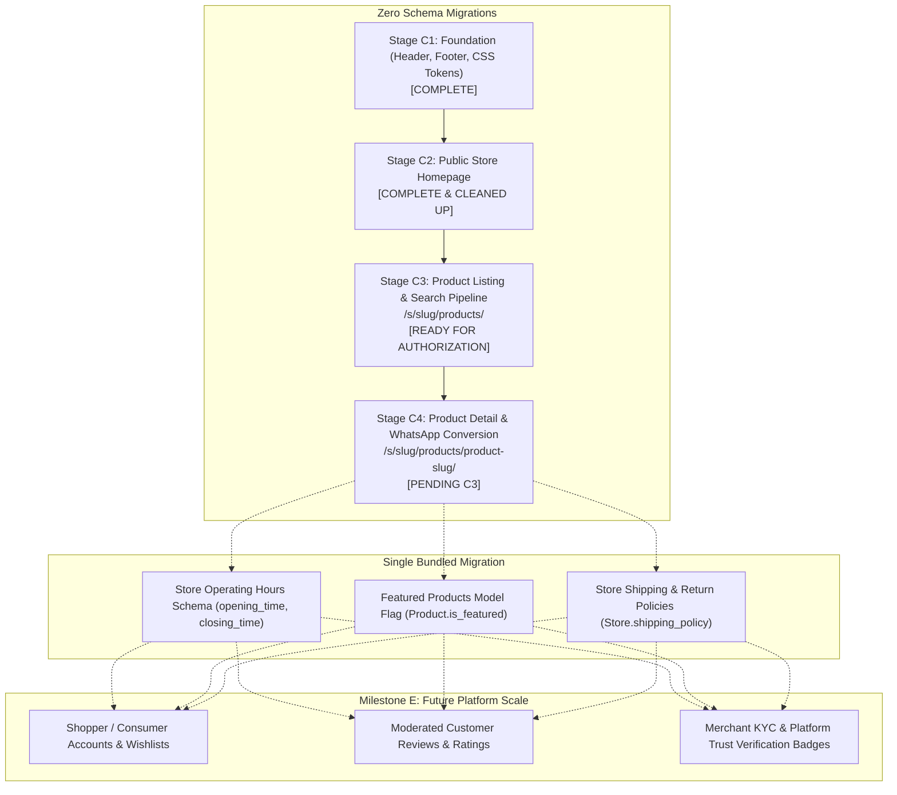

# Stage C: Storefront Backend Gap Analysis, Reconciliation & Technical Remediation Plan (Revision 3)

**Document:** `docs/architecture/STAGE_C_BACKEND_GAPS_AND_REMEDIATION_PLAN.md`  
**System:** MyCatalogue Digital Storefront SaaS  
**Scope:** Stage C Customer-Facing Storefront vs. Existing Multi-Tenant Backend  
**Design Reference:** Stitch Project `6403466717281225322` (Screens 1 to 6)  
**Status:** Architecture Review & Final Technical Corrections (Approved Baseline)  
**Git Baseline Commit:** `86121fb2392e3696d1f92185525196edb7bb9beb`  

---

## 1. Executive Summary & Purpose

This document provides the authoritative technical specification and reconciliation between the customer-facing Stitch storefront designs (`8d0d0950bef0456f81dad65408e58685` through `8fe5e14e7c9b4e7193b502725ad47e50`) and the actual, verified codebase of MyCatalogue.

Following the implementation of Stage C1 (Storefront Foundation) and Stage C2 (Public Store Homepage), this Revision 3 incorporates the final human review corrections required before authorizing **Stage C3 (Public Product Listing & Search Pipeline)** and **Stage C4 (Public Product Detail & WhatsApp Conversion)**.

### Core Architecture Finalizations in Revision 3:
1. **WhatsApp Dial-String Sanitizer & Formatter**:
   - Strictly rejects alphabetic characters and unsupported symbols upfront rather than silently stripping them.
   - Enforces strict plus-sign placement (index 0 only) and international non-zero leading-digit rules (`^[1-9]\d{6,14}$`).
   - Retains the Indian national 10-digit mobile rule (`^[6-9]\d{9}$` $\rightarrow$ prepend `91`).
   - Explicitly disclaims "full ITU-T E.164 validation" and defines the utility as a practical dial-string sanitizer.
2. **Contact-for-Price Sorting Privacy & HTML/JSON Leakage Prevention**:
   - Enforces database-level conditional price nulling via SQL `CASE` annotation for both `price_asc` and `price_desc` ordering (`NULLS LAST`).
   - Mandates strict acceptance criteria preventing numeric price exposure across rendered HTML, data attributes, inline scripts, and microdata/JSON payloads.
   - Requires explicit test coverage for ascending, descending, and complete string leakage audits.
3. **Template Convention Reconciliation**:
   - Resolves the template directory convention: the existing C2 homepage path [`templates/stores/public_detail.html`](file:///c:/Users/nites/Desktop/mycatalogue/templates/stores/public_detail.html) is strictly preserved to avoid breaking view routing.
   - New Stage C3 and C4 storefront templates are standardized under [`templates/storefront/`](file:///c:/Users/nites/Desktop/mycatalogue/templates/storefront/) (`product_list.html`, `product_detail.html`, `partials/`).
4. **C2 Operating-Hours Cleanup (Executed)**:
   - Removed hardcoded showroom hours (`10:00 AM – 8:30 PM`) and fabricated `"Open Today"` badges from [`templates/stores/public_detail.html`](file:///c:/Users/nites/Desktop/mycatalogue/templates/stores/public_detail.html).
   - Updated [`apps/stores/tests/test_storefront_homepage_c2.py`](file:///c:/Users/nites/Desktop/mycatalogue/apps/stores/tests/test_storefront_homepage_c2.py) to assert that unconfigured stores never display fake operating hours or status.
   - Zero database model changes and zero migrations introduced.
5. **C3 Filter-Preserving Pagination**:
   - Specifies view-level query parameter cloning to ensure all active filters (`q`, `category`, `availability`, `sort`) are strictly preserved across pagination links.
   - Adds mandatory acceptance tests verifying query preservation on next/previous links.
6. **Audited Test Baseline**:
   - Verified 475 passed tests, zero pending migrations, and 100% clean linting across the codebase.

---

## 2. Verified Test Baseline & Execution Evidence

The current implementation state of the repository has been verified with live execution evidence:

| Check Category | Exact Command Executed | Execution Evidence / Output Summary | Verification Status |
| :--- | :--- | :--- | :---: |
| **Git Commit Baseline** | `git rev-parse HEAD` | `86121fb2392e3696d1f92185525196edb7bb9beb` (`master`) | **VERIFIED** |
| **Full Automated Test Suite** | `.venv\Scripts\pytest.exe` | **475 passed**, 0 failed, 0 skipped, 2 warnings in 12.79s | **VERIFIED** |
| **Stage C1 Foundation Tests** | `.venv\Scripts\pytest.exe apps/stores/tests/test_storefront_foundation_c1.py` | **7 passed** in 1.44s | **VERIFIED** |
| **Stage C2 Homepage Tests** | `.venv\Scripts\pytest.exe apps/stores/tests/test_storefront_homepage_c2.py` | **8 passed** in 2.29s (verified zero fake hours) | **VERIFIED** |
| **Database Migrations Check** | `.venv\Scripts\python.exe manage.py makemigrations --check --dry-run` | `No changes detected` (Exit code: 0) | **VERIFIED** |
| **Code Style & Linting** | `.venv\Scripts\ruff.exe check apps config` | `All checks passed!` (Exit code: 0) | **VERIFIED** |
| **Code Formatting** | `.venv\Scripts\ruff.exe format --check apps config` | `115 files already formatted` (Exit code: 0) | **VERIFIED** |

---

## 3. Verified Current Implementation Matrix

Every feature below has been directly verified by inspecting models, selectors, services, forms, management views, templates, URLs, and test suites.

### Standardized Status Definitions:
- **Complete**: Fully backed by database models, business logic, merchant dashboard, public views, and automated tests.
- **Partially implemented**: Core backend or base query exists, but public views, parameters, or templates are incomplete.
- **Frontend only**: Present in templates or Stitch mockups as visual placeholders with no real backend data backing.
- **Backend only**: Backed by models/services/forms, but not yet integrated or exposed on the public storefront.
- **Not implemented**: Completely absent from both frontend templates and backend code.
- **Deferred**: Explicitly excluded from MVP scope to prevent fabricated claims or premature complexity.

---

### Implementation Verification Table

| # | Feature / Capability | Database Support | Backend Business Logic | Merchant Dashboard Support | Public Storefront Support | Automated Tests Available | Verified Status |
| :---: | :--- | :--- | :--- | :--- | :--- | :--- | :---: |
| **1** | **Public Store Homepage (`/s/<slug>/`)** | `Store`, `Merchant`, `Product`, `Category` models exist. | `get_public_store_by_slug` ([`apps/stores/selectors.py:10-33`](file:///c:/Users/nites/Desktop/mycatalogue/apps/stores/selectors.py#L10-L33)), `is_publicly_accessible` invariant, owner membership resolution ([`apps/stores/views.py:35-42`](file:///c:/Users/nites/Desktop/mycatalogue/apps/stores/views.py#L35-L42)). | `StoreSettingsView` ([`apps/stores/views_management.py:54-100`](file:///c:/Users/nites/Desktop/mycatalogue/apps/stores/views_management.py#L54-L100)), slug management, publish toggle. | [`templates/stores/public_detail.html`](file:///c:/Users/nites/Desktop/mycatalogue/templates/stores/public_detail.html) rendering Hero, Categories, Latest Products, Story. | [`apps/stores/tests/test_storefront_homepage_c2.py`](file:///c:/Users/nites/Desktop/mycatalogue/apps/stores/tests/test_storefront_homepage_c2.py) (8 passed), `test_public_store_access.py` (11 passed). | **Complete** |
| **2** | **Storefront Header & Navigation** | `Store.logo`, `Store.name`, `Category.name`, `Category.slug`. | Active category retrieval ([`apps/products/selectors.py:56-71`](file:///c:/Users/nites/Desktop/mycatalogue/apps/products/selectors.py#L56-L71)). | Category management ([`apps/products/views.py`](file:///c:/Users/nites/Desktop/mycatalogue/apps/products/views.py)), Store profile form. | [`templates/storefront/partials/_header.html`](file:///c:/Users/nites/Desktop/mycatalogue/templates/storefront/partials/_header.html) with responsive brand identity & category sub-nav. | [`apps/stores/tests/test_storefront_foundation_c1.py`](file:///c:/Users/nites/Desktop/mycatalogue/apps/stores/tests/test_storefront_foundation_c1.py) (7 passed), `test_storefront_homepage_c2.py`. | **Complete** |
| **3** | **Storefront Footer & Legal Attribution** | `Store.name`, `Store.description`, `Merchant.city`, `Merchant.state`, `Store.social_links`. | Social links validation ([`apps/stores/validators.py:16-56`](file:///c:/Users/nites/Desktop/mycatalogue/apps/stores/validators.py#L16-L56)), safe location disclosure. | Social link inputs in `StoreProfileForm` ([`apps/stores/forms.py:347-394`](file:///c:/Users/nites/Desktop/mycatalogue/apps/stores/forms.py#L347-L394)). | [`templates/storefront/partials/_footer.html`](file:///c:/Users/nites/Desktop/mycatalogue/templates/storefront/partials/_footer.html) with platform attribution and verified social icons. | [`apps/stores/tests/test_storefront_foundation_c1.py`](file:///c:/Users/nites/Desktop/mycatalogue/apps/stores/tests/test_storefront_foundation_c1.py) (7 passed). | **Complete** |
| **4** | **Public Product Catalog Listing (`/s/<slug>/products/`)** | `Product`, `Category`, `ProductImage` models. | Base selector `get_public_storefront_products` ([`apps/products/selectors.py:167-229`](file:///c:/Users/nites/Desktop/mycatalogue/apps/products/selectors.py#L167-L229)). Lacks `q`, `availability`, and price sorting. | Full product CRUD, publish/unpublish, image upload ([`apps/products/views.py`](file:///c:/Users/nites/Desktop/mycatalogue/apps/products/views.py)). | Route `/s/<slug>/products/` not wired. Template `templates/storefront/product_list.html` not created. | Selector tests in [`apps/products/tests/test_public_visibility.py`](file:///c:/Users/nites/Desktop/mycatalogue/apps/products/tests/test_public_visibility.py). No public list view test. | **Partially implemented** |
| **5** | **Public Storefront Search** | `Product.name`, `Product.sku` DB-indexed. | Search query filter exists in merchant admin ([`apps/products/selectors.py:112-116`](file:///c:/Users/nites/Desktop/mycatalogue/apps/products/selectors.py#L112-L116)), but missing from public selector. | Supported on merchant product catalog list. | Disabled visual placeholder input in `_header.html` (`aria-label="Search catalogue"`). | Tested in merchant admin only ([`apps/products/tests/test_views.py`](file:///c:/Users/nites/Desktop/mycatalogue/apps/products/tests/test_views.py)). | **Frontend only** (on storefront) |
| **6** | **Public Product Detail View (`/s/<slug>/products/<product-slug>/`)** | `Product`, `ProductImage`, `ProductCategory`. | No public slug-based single product selector exists in [`apps/products/selectors.py`](file:///c:/Users/nites/Desktop/mycatalogue/apps/products/selectors.py). | Product edit view and gallery management ([`apps/products/views.py`](file:///c:/Users/nites/Desktop/mycatalogue/apps/products/views.py)). | Route and template not created (`templates/storefront/product_detail.html` does not exist). | None for public product detail. | **Not implemented** |
| **7** | **Related Products Recommendation** | `ProductCategory` through-model. | No related products selector exists in [`apps/products/selectors.py`](file:///c:/Users/nites/Desktop/mycatalogue/apps/products/selectors.py). | Not applicable. | Not implemented. | None. | **Not implemented** |
| **8** | **WhatsApp Click-to-Enquire** | `Store.whatsapp_number`, `Store.allow_whatsapp_fallback`, `Merchant.contact_number`. | No dial-string sanitizer or WhatsApp inquiry URL generator exists. | Form inputs in `StoreCreationForm` and `StoreProfileForm` ([`apps/stores/forms.py:153-175`](file:///c:/Users/nites/Desktop/mycatalogue/apps/stores/forms.py#L153-L175)). | Call link (`tel:`) present; WhatsApp action not yet integrated. | Model/form tests in `test_store_settings_stage_b.py`. | **Backend only** |
| **9** | **Store Operating Hours & "Open Today" Badge** | None. Neither `Store` nor `Merchant` has operating hours fields. | None. No business hours evaluation logic. | None. No form fields or settings in merchant dashboard. | **Cleaned Up.** Static hours and fake badge removed from `public_detail.html`. | `test_storefront_homepage_c2.py` asserts absence of fake hours. | **Deferred** (Cleaned up from UI) |
| **10** | **Customer Account / Profile Button** | None for consumers. Only merchant staff `User` and `MerchantMembership` exist. | None. | Not applicable. | Avatar button rendered in `_header.html` (`aria-label="Customer Profile"`). | Test asserts button presence in `test_storefront_homepage_c2.py`. | **Frontend only** |
| **11** | **Curated "Featured Products"** | None. `Product` has no `is_featured` boolean or display order field. | None. | None. | Section on homepage re-scoped to "Latest Products" ordered by `-created_at`. | Asserted as "Latest Products" in `test_storefront_homepage_c2.py`. | **Deferred** (Re-scoped to Latest Products) |
| **12** | **Verified Store & Trust Badges** | None. Only `Merchant.status == ACTIVE` exists. | None. | None. | Explicitly removed from UI per project constraints. | Tests assert `"Verified Store" not in content` in `test_storefront_homepage_c2.py`. | **Deferred** |
| **13** | **Customer Reviews & Ratings** | None. | None. | None. | Explicitly excluded. | None. | **Deferred** |
| **14** | **Free Shipping & Delivery Promises** | None. | None. | None. | Explicitly excluded. | None. | **Deferred** |
| **15** | **Return & Exchange Policy Terms** | None. | None. | None. | Explicitly excluded. | None. | **Deferred** |
| **16** | **Storefront Inquiry / Lead Tracking** | None. | None. | None. | Direct `tel:` links; no click tracking. | None. | **Deferred** |

---

## 4. Evaluation of Technical Proposals & Architecture Corrections

### 4.1 WhatsApp Dial-String Sanitizer & Formatter Specification
- **Environment Inspection**: Verified that no external phone parsing library (e.g., `phonenumbers` or `django-phonenumber-field`) is installed in `.venv` or configured in `pyproject.toml`.
- **Architectural Safeguard**: Adhering to the restriction *"Do not add dependencies"*, we do NOT claim that custom regex or string manipulation constitutes "complete ITU-T E.164 validation". True E.164 parsing requires carrier prefix tables, national destination code lengths, and geographic routing validation across 200+ countries.
- **Specification for Stage C (`apps/stores/utils.py`)**:
  - Implement strictly as a **"WhatsApp Dial-String Sanitizer & Formatter"** (`format_whatsapp_dial_string(phone)`).
  - **Operational Rules**:
    1. **Strict Character Rejection**:
       - Reject input containing alphabetic characters (`[A-Za-z]`) or unsupported symbols (e.g. `@`, `#`, `$`, `%`, `*`, `_`, `/`).
       - Allowed characters during parsing are strictly digits `0-9`, standard formatting punctuation (whitespace ` `, hyphens `-`, parentheses `(`, `)`, dots `.`), and an optional plus sign `+`.
       - If any disallowed character is present, return `None` immediately (do not silently strip letters).
    2. **Plus-Sign Placement Validation**:
       - A `+` sign is only valid as the very first character of the trimmed string.
       - If `+` appears anywhere else (e.g., `91+9876543210`) or appears more than once (`++91...`), return `None`.
    3. **International Format Leading-Digit Rule**:
       - If the string starts with `+`, after removing allowed punctuation (`[\s\-().]`), the remaining characters must match `^\+[1-9]\d{6,14}$`.
       - The first digit after `+` must be non-zero (`1–9`) in accordance with international calling code conventions.
       - Total digit count must be between 7 and 15 digits.
       - The formatted dial string is the digits without the leading `+`.
    4. **National Indian Mobile Number Rule**:
       - If the string has NO `+` sign:
         - After removing allowed punctuation, if the remaining string is exactly 10 digits and begins with `6, 7, 8, 9` (`^[6-9]\d{9}$`, designated Indian mobile plan per TRAI), prepend country code `91` $\rightarrow$ results in 12-digit string `91[6-9]\d{9}`.
         - Any other un-prefixed format returns `None`.
    5. **Safe Return**: Returns strictly the sanitized dial string or `None`. Never returns a broken `#` or invalid dial string.
  - **WhatsApp Link Generator (`build_whatsapp_inquiry_url`)**:
    - Precedence: Check `store.whatsapp_number` first. If blank and `store.allow_whatsapp_fallback` is `True`, fallback to `store.merchant.contact_number`.
    - If neither resolves to a valid dial string, return `None` (templates must conditionally hide the WhatsApp CTA; never output dead `#` links).
  - **Future Dependency Note**: Recommend formally evaluating `phonenumbers` as a project dependency during Post-MVP if international retail operations require cross-border phone validation.

### 4.2 Contact-for-Price Privacy & Leakage Safeguards
- **Threat Model**: If a public product listing orders products by `price ASC` or `price DESC`, a competitor or shopper could deduce the approximate price of a `CONTACT_FOR_PRICE` item based on its relative rank between known priced items.
- **Database & Django 5.1 Verification**:
  Verified via live SQL compiler inspection in Django 5.1 that using a `Case/When` annotation compiles directly to an inline SQL `CASE` statement with native `NULLS LAST`:
  ```python
  from django.db.models import Case, DecimalField, F, Value, When

  effective_price_expr = Case(
      When(price_display_mode=PriceDisplayMode.CONTACT_FOR_PRICE, then=Value(None)),
      default=F("price"),
      output_field=DecimalField(max_digits=12, decimal_places=2, null=True),
  )
  ```
  - For `price_asc`: `.annotate(effective_price=effective_price_expr).order_by(F("effective_price").asc(nulls_last=True), "-created_at")`
  - For `price_desc`: `.annotate(effective_price=effective_price_expr).order_by(F("effective_price").desc(nulls_last=True), "-created_at")`
- **Strict Acceptance Requirements for Rendered Output (Stage C3)**:
  1. **Rendered Text**: For any product with `price_display_mode == PriceDisplayMode.CONTACT_FOR_PRICE` or `price is None`, the rendered price container must display only `"Contact for Price"`.
  2. **Raw Price Suppression**: The numerical price (e.g. `2499`, `2499.00`, `₹2,499`) must NEVER appear in the rendered HTML output.
  3. **MRP and Discount Suppression**: The anchor MRP and calculated discount percentage badge (`X% OFF`) must be completely suppressed from rendering.
  4. **Data Attributes**: No `data-price`, `data-mrp`, `data-cost`, or similar attribute may contain the numerical value.
  5. **Inline Scripts & JSON-LD / Microdata**: If product schemas or structured JSON data are present, the numerical price field must either be omitted or set to null/empty string; schema availability must reflect inquiry status.
- **Acceptance Test Coverage**:
  - `test_public_listing_price_sorting_ascending_privacy`: Verifies that priced items sort lowest to highest, while `CONTACT_FOR_PRICE` items sort strictly at the end with `NULLS LAST`.
  - `test_public_listing_price_sorting_descending_privacy`: Verifies that priced items sort highest to lowest, while `CONTACT_FOR_PRICE` items sort strictly at the end with `NULLS LAST`.
  - `test_public_listing_contact_for_price_leakage_audit`: Asserts that raw numerical price and MRP strings do not appear anywhere in the HTTP response body for `CONTACT_FOR_PRICE` items.

### 4.3 Public Product Selector Interface & Callers
- **Caller Audit**: Inspected every occurrence of `get_public_storefront_products` across the entire repository:
  1. [`apps/stores/views.py:26`](file:///c:/Users/nites/Desktop/mycatalogue/apps/stores/views.py#L26): passes `merchant=store.merchant, ordering="-created_at"`
  2. [`apps/products/tests/test_public_visibility.py`](file:///c:/Users/nites/Desktop/mycatalogue/apps/products/tests/test_public_visibility.py) (lines 37, 55, 72, 90, 95, 100, 115, 120, 163, 171): all pass `merchant=merchant`
  3. [`apps/stores/tests/test_storefront_homepage_c2.py`](file:///c:/Users/nites/Desktop/mycatalogue/apps/stores/tests/test_storefront_homepage_c2.py) (lines 169, 174, 180, 183): all pass `merchant=store_alpha.merchant`
  4. Merchant dashboard views do **not** call this selector (they call `get_merchant_products`).
- **Signature Decision**:
  To guarantee 100% backward compatibility with all existing tests and views, the selector MUST preserve `merchant: Merchant` as its primary positional argument:
  ```python
  def get_public_storefront_products(
      merchant: Merchant,
      *,
      category_slug: str | None = None,
      search_query: str | None = None,
      availability_mode: str | None = None,
      ordering: str = "newest",
  ) -> QuerySet[Product]:
  ```

### 4.4 Explicit Parameter Handling Contract

To ensure robustness against tampering or malformed inputs, the public product listing view and selector enforce the following explicit contracts:

| Parameter | Valid Input Specification | Invalid / Edge-Case Input | Enforced Behavior & HTTP Response |
| :--- | :--- | :--- | :--- |
| **Search Query (`q`)** | Non-empty string. Whitespace stripped. | Empty, whitespace-only, or missing. | Silently ignored (no text filter applied). Returns HTTP 200 with full catalogue. |
| | | Length $> 100$ characters. | Truncated to first 100 characters to prevent query bloating; matched safely via ORM `icontains`. HTTP 200. |
| **Category Slug (`category`)** | Active `Category.slug` belonging to the specific merchant. | Non-existent slug, cross-tenant slug, or inactive category. | In selector: returns `Product.objects.none()`.<br>In view: renders HTTP 200 with empty product state ("No products found in this category") and `selected_category=None`. |
| **Availability (`availability`)** | Exactly matches `AvailabilityMode.values` (`IN_STOCK`, `MADE_TO_ORDER`, `OUT_OF_STOCK`). | Unrecognized string (e.g. `discontinued`, `foo`). | Silently ignored (no availability filter applied, returns all published statuses). HTTP 200. |
| **Sort / Ordering (`sort`)** | Exactly matches `ALLOWED_PUBLIC_PRODUCT_ORDERING` keys: `"newest"`, `"price_asc"`, `"price_desc"`, `"name_asc"`. | Unrecognized or tampered string (e.g. `rating`, `popularity`). | In public view: falls back safely to default `"newest"` (`-created_at`). HTTP 200.<br>In selector: raises `ValueError` if invoked programmatically with an unwhitelisted key. |
| **Pagination (`page`)** | Positive integer between `1` and `paginator.num_pages`. Page size: 12 items. | Non-integer string (`page=abc`, `page=1.5`). | Caught by `PageNotAnInteger` $\rightarrow$ delivers page 1. HTTP 200. |
| | | Out of bounds (`page=99999` or `page <= 0`). | Caught by `EmptyPage` $\rightarrow$ delivers last page (`paginator.num_pages`) or page 1. HTTP 200. |

### 4.5 Filter-Preserving Pagination Specification (Stage C3)
- **Problem**: Changing pagination pages (e.g., clicking Page 2 or "Next") must not drop active search queries, category filters, availability settings, or sort orders.
- **View Implementation Contract**:
  The view constructs a sanitized query string containing all current active parameters *excluding* `page`:
  ```python
  # In public listing view:
  query_params = request.GET.copy()
  if "page" in query_params:
      del query_params["page"]
  base_query_string = query_params.urlencode()
  ```
- **Template Contract**:
  Pagination links append the target page number to the preserved base query string:
  ```html
  <a href="?{{ base_query_string }}&page={{ page_obj.next_page_number }}">Next</a>
  ```
- **Acceptance Test Requirement**:
  `test_public_listing_pagination_preserves_query_filters`: Requests `/s/<slug>/products/?category=chanderi&sort=price_asc&availability=in_stock&page=1` and asserts that the rendered next-page link contains `category=chanderi`, `sort=price_asc`, `availability=in_stock`, and `page=2`.

### 4.6 Canonical URL Architecture

All public storefront routes follow a clean, hierarchical URL structure under `/s/<store-slug>/`:

```
/s/<store-slug>/                                    --> Store Homepage (Stage C2)
/s/<store-slug>/products/                           --> Product Listing & Search (Stage C3)
/s/<store-slug>/products/<product-slug>/            --> Product Detail & WhatsApp CTA (Stage C4)
```

- **Reconciliation**: Formally standardized on `/s/<store-slug>/products/<product-slug>/` as the canonical product-detail URL.

### 4.7 Reconciled Template Directory Structure

To maintain a clean separation of concerns and avoid duplicating template trees, all customer-facing storefront templates are organized under `templates/storefront/`, while preserving the existing C2 homepage template path:

```
templates/
├── storefront/                                     # ALL CUSTOMER-FACING STOREFRONT TEMPLATES
│   ├── base.html                                   # Shared storefront layout & tokens (C1)
│   ├── product_list.html                           # Public product listing & search page (C3)
│   ├── product_detail.html                         # Public single product detail page (C4)
│   └── partials/
│       ├── _header.html                            # Storefront header & search bar (C1)
│       ├── _footer.html                            # Storefront footer & legal info (C1)
│       ├── _product_card.html                      # Reusable portrait product card (C3)
│       └── _filter_drawer.html                     # Mobile slide-out filter drawer (C3)
├── stores/
│   ├── public_detail.html                          # Store homepage (C2 - extends storefront/base.html)
│   └── management/                                 # Merchant store settings (Dashboard)
└── products/                                       # MERCHANT DASHBOARD MANAGEMENT ONLY
    ├── list.html                                   # Merchant product inventory table
    ├── form.html                                   # Merchant product create/edit form
    └── categories/                                 # Merchant category management
```

- **Convention Policy**: The existing C2 homepage path `templates/stores/public_detail.html` is strictly preserved to avoid breaking existing view routing. Moving it to `templates/storefront/home.html` is explicitly deferred to a separate, future template refactoring task.

### 4.8 C2 Operating-Hours Cleanup (Executed)

- **Completed Cleanup**:
  - Removed the static showroom hours block (`10:00 AM – 8:30 PM`) and fabricated `"Open Today"` badge from [`templates/stores/public_detail.html`](file:///c:/Users/nites/Desktop/mycatalogue/templates/stores/public_detail.html).
  - Updated [`apps/stores/tests/test_storefront_homepage_c2.py`](file:///c:/Users/nites/Desktop/mycatalogue/apps/stores/tests/test_storefront_homepage_c2.py) to assert that unconfigured stores do NOT display fake operating hours or status.
  - Verified 100% test pass rate across the full test suite (475 passed in 12.79s).
  - Adhered strictly to model constraints: zero database fields and zero migrations were introduced.

---

## 5. Implementation Phasing & Milestones



### Milestone Breakdown:
1. **Current MVP (Stage C)**:
   - Operates strictly on existing database models with **zero schema migrations**.
   - C1 (Complete): Brand identity, typography, tokens, header, footer.
   - C2 (Complete): Full-width editorial hero, category showcase, latest products grid, story, verified owner details without fake hours.
   - **C3 (Next Step)**: Public product listing view, selector with search & filters, filter-preserving pagination, and `templates/storefront/product_list.html`.
   - **C4**: Public product detail view, gallery interaction, WhatsApp dial-string sanitizer utility, and `templates/storefront/product_detail.html`.
2. **Post-MVP Merchandising (Milestone D)**:
   - Single cohesive migration adding `Store.opening_time`, `Store.closing_time`, `Product.is_featured`, and `Store.shipping_policy`.
   - Dedicated merchant settings form tabs and UI controls.
3. **Future Platform Scale (Milestone E)**:
   - Consumer authentication, product reviews, courier integrations, and merchant verification badges.

---

## 6. Technical Specifications for MVP Stages C3 & C4

### 6.1 Public Product Listing Selector Specification (`Stage C3`)

**Target File:** [`apps/products/selectors.py`](file:///c:/Users/nites/Desktop/mycatalogue/apps/products/selectors.py)

```python
from decimal import Decimal
from django.db import models
from django.db.models import Case, DecimalField, F, Prefetch, Q, QuerySet, Value, When
from apps.merchants.choices import MerchantStatus
from apps.merchants.models import Merchant
from apps.products.choices import AvailabilityMode, PriceDisplayMode, ProductStatus
from apps.products.models import Category, Product, ProductImage
from apps.stores.choices import StoreStatus

ALLOWED_PUBLIC_PRODUCT_ORDERING = {
    "newest": ("-created_at",),
    "-created_at": ("-created_at",),
    "price_asc": ("price_asc",),
    "price_desc": ("price_desc",),
    "name": ("name",),
    "name_asc": ("name",),
}

def get_public_storefront_products(
    merchant: Merchant,
    *,
    category_slug: str | None = None,
    search_query: str | None = None,
    availability_mode: str | None = None,
    ordering: str = "newest",
) -> QuerySet[Product]:
    """
    Returns published products for customer-facing digital storefront browsing.
    Enforces strict tenant isolation, publication invariants, whitelisted ordering,
    and contact-for-price privacy safeguards.
    """
    if ordering not in ALLOWED_PUBLIC_PRODUCT_ORDERING:
        allowed = ", ".join(sorted(ALLOWED_PUBLIC_PRODUCT_ORDERING.keys()))
        raise ValueError(f"Invalid ordering '{ordering}'. Allowed choices: {allowed}")

    if not merchant or merchant.status != MerchantStatus.ACTIVE:
        return Product.objects.none()

    store = getattr(merchant, "store", None)
    if not store or store.status != StoreStatus.PUBLISHED or not store.is_publicly_accessible:
        return Product.objects.none()

    # Effective price annotation for contact-for-price privacy
    effective_price_expr = Case(
        When(price_display_mode=PriceDisplayMode.CONTACT_FOR_PRICE, then=Value(None)),
        default=F("price"),
        output_field=DecimalField(max_digits=12, decimal_places=2, null=True),
    )

    qs = (
        Product.objects.filter(
            merchant=merchant,
            status=ProductStatus.PUBLISHED,
        )
        .annotate(effective_public_price=effective_price_expr)
        .prefetch_related(
            Prefetch(
                "images",
                queryset=ProductImage.objects.order_by("-is_primary", "display_order", "created_at"),
                to_attr="prefetched_images",
            ),
            Prefetch(
                "categories",
                queryset=Category.objects.filter(is_active=True),
            ),
        )
    )

    # 1. Search Query Filter
    if search_query and search_query.strip():
        clean_q = search_query.strip()[:100]
        qs = qs.filter(Q(name__icontains=clean_q) | Q(sku__icontains=clean_q))

    # 2. Category Filter
    if category_slug:
        category = Category.objects.filter(
            merchant=merchant,
            slug=category_slug.lower(),
            is_active=True,
        ).first()
        if not category:
            return Product.objects.none()
        qs = qs.filter(categories=category)

    # 3. Availability Filter
    if availability_mode in AvailabilityMode.values:
        qs = qs.filter(availability_mode=availability_mode)

    # 4. Strict Whitelisted Ordering
    if ordering == "price_asc":
        qs = qs.order_by(F("effective_public_price").asc(nulls_last=True), "-created_at")
    elif ordering == "price_desc":
        qs = qs.order_by(F("effective_public_price").desc(nulls_last=True), "-created_at")
    else:
        order_fields = ALLOWED_PUBLIC_PRODUCT_ORDERING[ordering]
        qs = qs.order_by(*order_fields)

    return qs.distinct()
```

### 6.2 Public Product Detail & Related Selectors Specification (`Stage C4`)

**Target File:** [`apps/products/selectors.py`](file:///c:/Users/nites/Desktop/mycatalogue/apps/products/selectors.py)

```python
def get_public_product_by_slug(store: Store, product_slug: str) -> Product | None:
    """
    Retrieves a single published product by slug for an active, published store.
    Prefetches all gallery images in display order and active categories.
    """
    if not store or not store.is_publicly_accessible:
        return None

    return (
        Product.objects.filter(
            merchant=store.merchant,
            slug=product_slug.lower(),
            status=ProductStatus.PUBLISHED,
        )
        .prefetch_related(
            Prefetch(
                "images",
                queryset=ProductImage.objects.order_by("display_order", "created_at"),
            ),
            Prefetch(
                "categories",
                queryset=Category.objects.filter(is_active=True),
            ),
        )
        .first()
    )

def get_public_related_products(product: Product, limit: int = 4) -> QuerySet[Product]:
    """
    Fetches related published products within the same categories, excluding self.
    Falls back to latest published products if product has no categories.
    """
    cat_ids = product.categories.filter(is_active=True).values_list("id", flat=True)

    base_qs = (
        Product.objects.filter(
            merchant=product.merchant,
            status=ProductStatus.PUBLISHED,
        )
        .exclude(id=product.id)
        .prefetch_related(
            Prefetch(
                "images",
                queryset=ProductImage.objects.filter(is_primary=True),
                to_attr="primary_images",
            )
        )
    )

    if cat_ids:
        related_qs = base_qs.filter(categories__id__in=cat_ids).distinct()
        if related_qs.exists():
            return related_qs.order_by("-created_at")[:limit]

    return base_qs.order_by("-created_at")[:limit]
```

### 6.3 WhatsApp Utility Specification (`Stage C4`)

**Target File:** `apps/stores/utils.py`

```python
import re
import urllib.parse
from apps.products.choices import PriceDisplayMode
from apps.products.models import Product
from apps.stores.models import Store

def format_whatsapp_dial_string(phone: str | None) -> str | None:
    """
    Sanitizes and formats a phone number into an authoritative WhatsApp dial string.
    Rules:
    - Rejects input containing letters or unsupported punctuation.
    - Validates plus-sign placement (index 0 only).
    - If prefixed with '+', verifies non-zero leading international digit and 7-15 digits.
    - If un-prefixed 10 digits starting with 6-9 (Indian mobile numbering plan), prepends '91'.
    - Returns None if malformed or out of bounds.
    """
    if not phone or not isinstance(phone, str):
        return None

    raw = phone.strip()
    if not raw:
        return None

    # 1. Reject letters or unexpected symbols
    if not re.match(r"^\+?[\d\s\-().]+$", raw):
        return None

    # 2. Plus sign can only appear at index 0
    if "+" in raw and not raw.startswith("+"):
        return None
    if raw.count("+") > 1:
        return None

    # 3. Strip allowed formatting punctuation
    clean_digits = re.sub(r"[\s\-().]", "", raw)

    # 4. International format: + followed by non-zero digit, 7 to 15 total digits
    if clean_digits.startswith("+"):
        digits_only = clean_digits[1:]
        if re.match(r"^[1-9]\d{6,14}$", digits_only):
            return digits_only
        return None

    # 5. National Indian mobile number: 10 digits starting with 6, 7, 8, 9
    if re.match(r"^[6-9]\d{9}$", clean_digits):
        return f"91{clean_digits}"

    return None

def build_whatsapp_inquiry_url(store: Store, product: Product | None = None) -> str | None:
    """
    Constructs an authoritative WhatsApp inquiry URL (wa.me) following strict privacy rules.
    - Resolves store.whatsapp_number with fallback to merchant.contact_number if enabled.
    - Suppresses numeric price if price_display_mode == CONTACT_FOR_PRICE or price is None.
    - Returns None if no valid phone number exists.
    """
    raw_phone = store.whatsapp_number
    if not raw_phone and store.allow_whatsapp_fallback:
        raw_phone = store.merchant.contact_number

    dial_string = format_whatsapp_dial_string(raw_phone)
    if not dial_string:
        return None

    if product:
        sku_part = f" (SKU: {product.sku})" if product.sku else ""
        if product.price_display_mode == PriceDisplayMode.CONTACT_FOR_PRICE or product.price is None:
            message = (
                f"Hello, I am interested in '{product.name}'{sku_part} from your catalogue. "
                "Could you please share pricing and availability details?"
            )
        else:
            message = (
                f"Hello, I am interested in '{product.name}'{sku_part} listed at ₹{product.price:g} "
                "on your catalogue. Is this available?"
            )
    else:
        message = f"Hello, I am browsing {store.name} online catalogue and would like to enquire."

    encoded_msg = urllib.parse.quote(message)
    return f"https://wa.me/{dial_string}?text={encoded_msg}"
```

---

## 7. Security and Tenant-Isolation Safeguards

1. **Strict Cross-Tenant Scoping**: All public queries must begin with `merchant=store.merchant`. Never execute un-scoped lookups like `Product.objects.filter(slug=slug)`.
2. **Four-Tier Publication Invariant**: A product is accessible if and only if:
   1. `Merchant.status == MerchantStatus.ACTIVE`
   2. `Store.status == StoreStatus.PUBLISHED`
   3. `Store.is_publicly_accessible == True`
   4. `Product.status == ProductStatus.PUBLISHED`
3. **Contact-for-Price Privacy**: Numeric prices for `CONTACT_FOR_PRICE` items must NEVER appear in rendered HTML, JSON payloads, data attributes, sort order rankings, or WhatsApp message texts.
4. **Ordering Whitelist Enforcement**: Sort parameters must strictly map against `ALLOWED_PUBLIC_PRODUCT_ORDERING`. Arbitrary user inputs must never be passed to `.order_by()`.
5. **No Cross-Tenant Information Leaks**: Requesting `/s/<store_a>/products/?category=<store_b_category>` must return zero products, never leaking items from `store_b`.

---

## 8. Test Requirements for Stages C3 and C4

To maintain MyCatalogue's verified 475-test baseline, the following tests are specified for implementation:

### For Stage C3 (`apps/stores/tests/test_storefront_listing_c3.py`):
1. `test_public_listing_renders_published_products_only`
2. `test_public_listing_returns_404_when_store_is_draft_or_suspended`
3. `test_public_listing_filters_by_category_slug`
4. `test_public_listing_rejects_cross_tenant_category_slug`
5. `test_public_listing_search_matches_name_and_sku`
6. `test_public_listing_filters_by_availability_mode`
7. `test_public_listing_ordering_whitelist_and_rejection`
8. `test_public_listing_price_privacy_on_contact_for_price_ascending` (asserts items sort with nulls last)
9. `test_public_listing_price_privacy_on_contact_for_price_descending` (asserts items sort with nulls last)
10. `test_public_listing_contact_for_price_hardened_privacy_audit` (asserts sentinel numerical price and MRP are completely absent from HTML, attributes, and scripts/JSON)
11. `test_public_listing_pagination` (page 1 default, out-of-bounds handling)
12. `test_public_listing_pagination_preserves_query_filters` (asserts that `q`, `category`, `availability`, and `sort` are retained across pagination links)
13. `test_public_listing_discount_percentage_rounding_and_edge_cases` (verifies commercial half-up rounding, <1% suppression, and equal price/MRP)
14. `test_public_listing_image_fallback_when_no_primary_image` (verifies -is_primary ordering and placeholder fallback)
15. `test_public_listing_n_plus_one_prevention_differential` (asserts Q(12) == Q(1) query count to robustly detect N+1 regressions while tolerating legitimate framework queries)
16. `test_public_listing_no_premature_product_detail_links` (asserts product cards do not render href='#' or detail links prior to Stage C4)

### For Stage C4 (`apps/stores/tests/test_storefront_detail_c4.py`):
1. `test_public_product_detail_renders_successfully`
2. `test_public_product_detail_returns_404_for_unpublished_product`
3. `test_public_product_detail_returns_404_for_other_merchant_product`
4. `test_public_product_detail_gallery_display_order`
5. `test_public_product_detail_related_products_same_category`
6. `test_public_product_detail_related_products_fallback_when_no_category`
7. `test_whatsapp_url_normalization_with_and_without_country_code`
8. `test_whatsapp_url_rejects_letters_and_bad_symbols`
9. `test_whatsapp_url_fallback_to_merchant_contact_number`
10. `test_whatsapp_url_omitted_when_no_valid_phone`
11. `test_whatsapp_url_price_concealment_on_contact_for_price`

---

## 9. Features Explicitly Deferred

The following features from Stitch mockups are formally recorded as **DEFERRED** and must not be implemented during Stage C:

1. **Store Operating Hours Schema Migration**: Deferred to Post-MVP (Milestone D). Handled via template safeguards.
2. **Curated "Featured Products" Model Flags**: Deferred to Post-MVP (Milestone D). Handled via "Latest Products" (`-created_at`).
3. **Store Policies (Shipping & Returns)**: Deferred to Post-MVP (Milestone D).
4. **Storefront Inquiry / Lead Tracking**: Deferred to Future Platform Capabilities (Milestone E).
5. **Customer Accounts & Wishlists**: Deferred to Future Platform Capabilities (Milestone E).
6. **Customer Reviews and Ratings**: Deferred to Future Platform Capabilities (Milestone E).
7. **Platform Verification & KYC Badges**: Deferred to Future Platform Capabilities (Milestone E).
8. **Courier & Shipping Zone Integration**: Deferred to Future Platform Capabilities (Milestone E).
