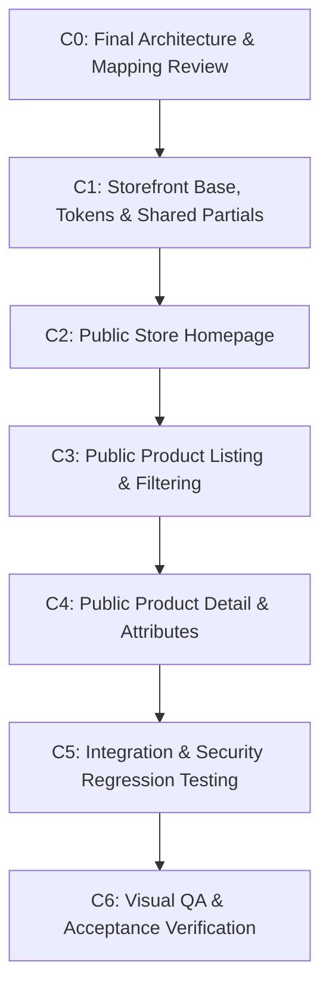

# Stage C: Customer-Facing Digital Storefront — Stitch Extraction & Implementation Plan (Revision 2)

**Document:** `docs/architecture/STAGE_C_STOREFRONT_STITCH_PLAN.md`  
**Revision:** 2 (Architecture Review Corrections & MVP Alignment)  
**Status:** PROPOSED & PENDING HUMAN APPROVAL  
**Stitch Project:** MyCatalogue Digital Storefront SaaS (ID: `6403466717281225322`)  
**Scope:** Stage C — Public Customer-Facing Storefront  
**Strict Constraint:** Planning and architecture documentation only. No application code, templates, migrations, or dependencies modified.

---

## 1. Verified Stitch Extraction Evidence

All six customer-facing screens from Stitch project `6403466717281225322` have been downloaded, saved to `scratch/stitch_audit/`, and programmatically verified for file existence, parsing integrity, and image decodability.

### Asset Verification Audit

| # | Screen Name | Stitch Screen ID | Device | Verified Files | File Size | DOM Elements / Resolution | Verification Status |
|---|-------------|------------------|--------|----------------|-----------|---------------------------|---------------------|
| **1** | Mobile Product Detail — Royal Blue Chanderi Saree | `8d0d0950bef0456f81dad65408e58685` | Mobile | `storefront_01_mobile_product_detail.html`<br>`storefront_01_mobile_product_detail.png` | 31,736 bytes<br>1,878,468 bytes | 216 DOM elements<br>780 × 5064 px (RGB) | Verified: Parsed HTML OK (`title: Product Details - Krishna Garments`); Valid PNG image. |
| **2** | Mobile Store Homepage — Krishna Garments | `43ec8b47c21f4fae986f14b63c13e7ef` | Mobile | `storefront_02_mobile_store_homepage.html`<br>`storefront_02_mobile_store_homepage.png` | 41,815 bytes<br>2,694,153 bytes | 290 DOM elements<br>780 × 5166 px (RGB) | Verified: Parsed HTML OK (`title: Store Catalogue - Krishna Garments`); Valid PNG image. |
| **3** | Product Detail — Royal Blue Chanderi Saree | `e230b3fbf5504b4d8ee6dcc06dcbbdde` | Desktop | `storefront_03_desktop_product_detail.html`<br>`storefront_03_desktop_product_detail.png` | 47,523 bytes<br>6,926,195 bytes | 321 DOM elements<br>2560 × 5408 px (RGB) | Verified: Parsed HTML OK; Valid PNG image. |
| **4** | Mobile Products Listing — Myntra Style | `a8715da9fbd24490adacb03a3edccdb2` | Mobile | `storefront_04_mobile_products_listing.html`<br>`storefront_04_mobile_products_listing.png` | 23,443 bytes<br>1,543,211 bytes | 190 DOM elements<br>780 × 2808 px (RGB) | Verified: Parsed HTML OK (`title: Store Catalogue - Krishna Garments`); Valid PNG image. |
| **5** | All Products Listing — Krishna Garments | `117d821b1fc347fbbea5873a702aef80` | Desktop | `storefront_05_desktop_products_listing.html`<br>`storefront_05_desktop_products_listing.png` | 62,329 bytes<br>6,517,049 bytes | 474 DOM elements<br>2560 × 5310 px (RGB) | Verified: Parsed HTML OK; Valid PNG image. |
| **6** | Store Homepage — Krishna Garments | `8fe5e14e7c9b4e7193b502725ad47e50` | Desktop | `storefront_06_desktop_store_homepage.html`<br>`storefront_06_desktop_store_homepage.png` | 61,851 bytes<br>10,574,945 bytes | 459 DOM elements<br>2560 × 7118 px (RGB) | Verified: Parsed HTML OK; Valid PNG image. |

- **Missing or Incomplete Assets:** None. All 6 HTML files and all 6 PNG screenshots exist and are fully readable.
- **Screen ID Confirmation:** The 6 resource identifiers strictly correspond to the project screen definitions requested by the human developer.

---

## 2. Feature Scope De-scoping & Policy for Unsupported Claims

The Stitch mockups represent a sample demonstration for a boutique titled "Krishna Garments" and contain mock marketing copy, unconfigured showroom promises, and speculative merchant commitments. MyCatalogue is a multi-tenant SaaS platform where merchants manage their own catalogues.

### Explicitly Excluded Features (Not in MVP / No Backend Support)
To prevent misleading consumer expectations and preserve platform integrity, the following features from the Stitch mockups are **strictly excluded**:

1. **Free Shipping Claims:** Exclude "Free Delhi NCR Ship" and shipping threshold banners. The MVP has no shipping zone engine or shipping cost configuration.
2. **Customer Reviews and Ratings:** Exclude star ratings (e.g. `★ 4.9`), review counts, and customer feedback blocks. No review model or moderation workflow exists.
3. **Unverified Merchant Badges:** Exclude hardcoded "Verified Silk Mark", "Est. 1982 Katra Neel", and "Direct Artisan Sourcing" badges. Only merchant-provided data will be shown.
4. **Response-Time Claims:** Exclude "Responds in ~4 mins" or "Typically replies instantly".
5. **Live Video Consultations:** Exclude "Want a Live Video Drape? Master Rajesh shows borders over WhatsApp video call".
6. **Delivery Estimates:** Exclude "Delivered in 2-3 business days" or countdown dispatch timers.
7. **Exchange and Return Guarantees:** Exclude "7 Days Doorstep Exchanges". No return policy engine exists in MVP.
8. **Hardcoded Showroom Hours & Transport Directions:** Exclude "Open Daily: 11:30 AM – 8:00 PM" and "Nearest Metro: Chandni Chowk Gate 5". The `Store` model does not support operating hour fields or metro coordinates.
9. **Artisan & Heritage Storytelling Blocks:** Exclude hardcoded artisan background stories ("42 Years of Handloom Curation"). If a merchant provides a store `description`, that text will be rendered; otherwise, no speculative copy is displayed.
10. **Unconfigured Tailoring / Showroom Services:** Exclude "Counter Pickup available" and "On-the-spot fall-pico".

### Permitted Content (Backed by Real Merchant Data)
- **Store Identity:** `Store.name`, `Store.tagline`, `Store.description`, `Store.logo`, `Store.cover_image`.
- **Location & Contact:** `Merchant.city`, `Merchant.state` (publicly safe location data; exact street address and PIN code withheld for privacy).
- **Social Presence:** `Store.social_links` (supported platforms: Instagram, Facebook, YouTube, Twitter/X, Pinterest, Website — matching `ALLOWED_SOCIAL_PLATFORMS` in `apps/stores/validators.py`).
- **Product Details:** `Product.name`, `Product.sku`, `Product.description`, `Product.price`, `Product.mrp`, `Product.price_display_mode`, `Product.availability_mode`, `Product.attributes`, `ProductImage` gallery.
- **WhatsApp Inquiry:** Authorized inquiry link constructed from `Store.whatsapp_number` (with fallback to `Merchant.contact_number`).

---

## 3. Evidence-Based Backend Capability Matrix

The following matrix documents the exact status of existing models, selectors, validators, and services in the MyCatalogue repository:

| Capability / Requirement | Status | Existing File & Code Reference | Required Modification / Action |
|--------------------------|--------|--------------------------------|--------------------------------|
| **Store & Merchant Relationship** | **Existing & Reusable** | `apps/stores/models.py:21-26` (`Store.merchant = OneToOneField('merchants.Merchant', on_delete=PROTECT, related_name='store')`) | None. Already implemented and protected. |
| **Public Store Visibility** | **Existing & Reusable** | `apps/stores/selectors.py:10-33` (`get_public_store_by_slug`); `apps/stores/models.py:112-119` (`is_publicly_accessible`) | None. Verified: Requires `Store.status == PUBLISHED` and `Merchant.status == ACTIVE`. |
| **Public Products Visibility (List)** | **Existing & Reusable** | `apps/products/selectors.py:160-214` (`get_public_storefront_products`) | Reusable base query. Requires filter parameter extensions (see below). |
| **Public Single Product Detail Lookup** | **Missing & Requiring Implementation** | `apps/products/selectors.py` has `get_product_for_merchant` (management only); no public slug-based selector exists. | Implement `get_public_product_by_slug(store: Store, product_slug: str) -> Product \| None` enforcing public visibility and store ownership. |
| **Featured Products** | **Not Part of the MVP** | Verified: `Product` has no `is_featured` field (`Product._meta.get_fields()`). | Do not modify schema. The store homepage will display the latest 8 published products (`[:8]`) as curated highlights. |
| **Recently Added Products Selector** | **Existing but Requiring Modification** | `apps/products/selectors.py:198` orders public products by `name`. | Add `ordering: str = "newest"` to `get_public_storefront_products` supporting `-created_at`. |
| **Category Selection & Filtering** | **Existing & Reusable** | `apps/products/selectors.py:56-71` (`get_merchant_categories`); `apps/products/selectors.py:201-213` (filters `category_slug`). | Reusable directly in storefront view contexts. |
| **Availability Filtering** | **Existing but Requiring Modification** | `apps/products/models.py:159-165` defines `availability_mode`. `apps/products/selectors.py:160` lacks availability parameter. | Add `availability_mode: str \| None = None` filter parameter to `get_public_storefront_products`. |
| **Search by Name & SKU** | **Existing but Requiring Modification** | `apps/products/selectors.py:112-116` implements search in `get_merchant_products`; public selector lacks it. | Port `Q(name__icontains=q) \| Q(sku__icontains=q)` into `get_public_storefront_products`. |
| **Price Sorting** | **Existing but Requiring Modification** | `apps/products/selectors.py:198` lacks price ordering. | Add `price_asc` and `price_desc` ordering support in selector with `nulls_last=True`. |
| **Pagination** | **Existing & Reusable** | Standard `django.core.paginator.Paginator` used in merchant views (`apps/products/views.py:56`). | Instantiate `Paginator` in public product list view (page size: 12 or 24). |
| **Product Gallery Selection** | **Existing & Reusable** | `apps/products/models.py:512-515` (`Product.primary_image`); `ProductImage` ordering by `display_order, created_at`. | Prefetch all gallery images on detail view; prefetch primary image on list/homepage. |
| **Structured Attribute Display** | **Missing & Requiring Implementation** | `Product.attributes` JSON validated by `apps/products/validators.py:27-142`. No public presentation helper exists. | Implement template helper/partial to render valid attribute types (`text`, `number`, `single_select`, `multi_select`, `color`). |
| **Related Products Selection** | **Missing & Requiring Implementation** | No related products selector exists in `apps/products/selectors.py`. | Implement `get_related_products(product: Product, limit: int = 4) -> QuerySet[Product]` filtering same merchant/category, excluding current product. |
| **WhatsApp Number & Fallback** | **Existing but Requiring Modification** | `apps/stores/models.py:54-65` defines fields; `apps/merchants/forms.py:9` has `PHONE_REGEX`. | Implement `build_whatsapp_inquiry_url` helper with strict international normalization and privacy rules. |

---

## 4. Simplified Public Product Listing Specification

To ensure a fast, robust, and maintainable implementation aligned with the existing backend, the public product listing page (`/s/<store_slug>/products/`) will support **only** the following core capabilities:

### Supported Query Parameters
1. **Search (`q`):**
   - Case-insensitive substring matching against `Product.name` and `Product.sku`.
   - Whitespace trimmed; queries $< 1$ character ignored.
2. **Category Filter (`category`):**
   - Matches `Category.slug` belonging to the active merchant with `is_active=True`.
3. **Availability Filter (`availability`):**
   - Valid choices: `in_stock`, `made_to_order`, `out_of_stock`.
   - Maps directly to `AvailabilityMode.choices`.
4. **Ordering (`sort`):**
   - `newest`: `-created_at` (default).
   - `price_asc`: `price` ascending (nulls last).
   - `price_desc`: `price` descending (nulls last).
5. **Pagination (`page`):**
   - Standard integer page number; defaults to 1. Page size: 12 items.

### Explicitly Excluded from Listing Scope
- **No arbitrary price range buckets** (e.g. "Under ₹500", "₹500–₹1500").
- **No dynamic attribute faceting** (e.g. multi-select attribute filters for Fabric/Weave).
- **No unapproved sort options** (e.g. "Most Popular" or "Customer Rating" which have no backend metric).

---

## 5. Revised WhatsApp Inquiry Architecture & Utility Design

### 5.1 Authoritative Precedence & Fallback Rules
1. **Primary Number:** If `store.whatsapp_number` is populated with non-whitespace characters, it takes highest precedence.
2. **Fallback Number:** If `store.whatsapp_number` is blank/empty **AND** `store.allow_whatsapp_fallback` is `True`, fallback to `store.merchant.contact_number`.
3. **No Valid Number:** If neither number is available (or if fallback is disabled and the store number is blank), **no WhatsApp link is generated**.

### 5.2 Strict Fallback Behavior (No Dead Links)
- Under no circumstances shall `build_whatsapp_inquiry_url()` return a `#` anchor link.
- When no valid phone number exists, the function returns `None`.
- In templates, the presence of the WhatsApp link is conditionally checked:
  ```django
  
      <a href="{{ whatsapp_url }}" target="_blank" rel="noopener noreferrer" class="...">
          Chat on WhatsApp
      </a>
  
      <!-- Button is cleanly omitted or replaced by a non-link information pill -->
  
  ```

### 5.3 International Phone Normalization & Validation
- **No Assumed Country Code:** MyCatalogue does not assume all merchants are Indian. Do not blindly prepend `91`.
- **Normalization Algorithm:**
  1. Strip leading and trailing whitespace.
  2. If the string starts with `+`, strip the leading `+`.
  3. Strip all formatting punctuation: spaces, hyphens `-`, parentheses `(`, `)`, dots `.`, and slashes `/`.
  4. Ensure remaining characters are strictly numeric digits `[0-9]`.
  5. Validate length against the international ITU-T E.164 standard: **minimum 7 digits, maximum 15 digits**.
  6. If the resulting string contains non-digits or falls outside the 7–15 digit boundary, mark the number as **invalid** and return `None`.

### 5.4 Contextual Message Generation & Price Privacy
All messages are URL-encoded using Python's `urllib.parse.quote()` and strictly exclude unsupported promises:

1. **Product Enquiry — `PriceDisplayMode.SHOW_PRICE`:**
   ```
   Hello, I would like to enquire about '{product.name}' (SKU: {sku}) listed at ₹{price} on your catalogue.
   ```
2. **Product Enquiry — `PriceDisplayMode.CONTACT_FOR_PRICE` (Strict Privacy Rule):**
   *Under no circumstances may the numeric price appear in the WhatsApp message text, URL parameter, HTML element, or data attribute.*
   ```
   Hello, I would like to enquire about the price and availability of '{product.name}' (SKU: {sku}) on your catalogue.
   ```
3. **Product Enquiry — Unavailable / Out of Stock (`OUT_OF_STOCK`):**
   ```
   Hello, I noticed that '{product.name}' (SKU: {sku}) is currently out of stock. Could you let me know when it might be available again?
   ```
4. **General Store Enquiry (Homepage / Footer):**
   ```
   Hello, I am browsing your catalogue at {store.name} and would like to enquire about your products.
   ```

---

## 6. Security & Tenant Isolation Acceptance Matrix

Public storefront views must undergo explicit, automated security and privacy verification:

| Security Invariant | Verification Condition | Expected Test Behavior |
|--------------------|------------------------|------------------------|
| **Cross-Tenant Product Isolation** | Store A attempts to display Store B products in its listing or homepage. | Queryset strictly filters `merchant=store.merchant`. Store B products never appear. |
| **Direct URL Product Tampering** | User requests `/s/<store-a-slug>/products/<store-b-product-slug>/`. | View validates `product.merchant == store.merchant`. Returns **HTTP 404** (not HTTP 200, not 403). |
| **Draft Product Protection** | User directly requests `/s/<store-slug>/products/<draft-product-slug>/`. | Selector excludes non-published products. Returns **HTTP 404**. |
| **Archived Product Protection** | User requests `/s/<store-slug>/products/<archived-product-slug>/`. | Selector excludes archived products. Returns **HTTP 404**. |
| **Unpublished Store Protection** | User requests `/s/<draft-or-unpublished-store-slug>/`. | Returns **HTTP 404**. |
| **Inactive Merchant Protection** | Merchant status is `PENDING`, `SUSPENDED`, or `INACTIVE`. | All public endpoints for this store return **HTTP 404**. |
| **Contact-for-Price Leak Prevention** | Product has `price_display_mode=CONTACT_FOR_PRICE`. | HTML response body, script tags, meta tags, and data attributes do NOT contain numeric `product.price`. |
| **Private Tenant Data Concealment** | Inspect public storefront HTML payload for any store. | Does NOT leak `store.id`, `merchant.id`, `merchant.address`, `merchant.pin_code`, `merchant.status`, or internal user email addresses. |

---

## 7. Revised Screen-to-Template Architecture

Customer storefronts use a dedicated layout hierarchy separate from the merchant administration dashboard:

```
templates/
└── storefront/
    ├── base.html                     <- Common Stitch design system, Plus Jakarta Sans, Space Grotesk, Material Icons
    ├── homepage.html                 <- Public Store Homepage (Screens 2 & 6 responsive)
    ├── product_list.html             <- Public Product Listing (Screens 4 & 5 responsive)
    ├── product_detail.html           <- Public Product Detail (Screens 1 & 3 responsive)
    └── partials/
        ├── _header.html              <- Store logo, cover, tagline, announcement bar
        ├── _footer.html              <- Physical city/state, social links, copyright
        ├── _product_card.html        <- Reusable product card (dual pricing, stock badge, WhatsApp CTA)
        ├── _filter_drawer.html       <- Mobile filter bottom sheet (Myntra style)
        └── _attribute_table.html     <- Customer-facing structured specifications renderer
```

### URL Routing Specification

```
config/urls.py
└── path("s/", include("apps.stores.urls", namespace="stores"))

apps/stores/urls.py
├── path("settings/...", ...)                                          [Management endpoints]
├── path("<slug:store_slug>/", views.public_store_homepage, name="public_detail")
├── path("<slug:store_slug>/products/", views.public_product_list, name="public_product_list")
└── path("<slug:store_slug>/products/<slug:product_slug>/", views.public_product_detail, name="public_product_detail")
```

---

## 8. Corrected Implementation Phases

Implementation will proceed sequentially across seven structured phases (C0 through C6):



### Phase C0: Architecture & Mapping Review (Current Phase)
- **Objective:** Finalize Revision 2 of the Stage C planning document, aligning scope with the human developer's specifications.
- **Deliverables:** `docs/architecture/STAGE_C_STOREFRONT_STITCH_PLAN.md`.
- **Constraint:** Zero code changes.

### Phase C1: Storefront Base, Design System & Shared Components
- **Objective:** Establish the foundational frontend layout and design system for customer-facing storefronts.
- **Existing Files to Reuse:** `templates/base.html` (static assets reference), `apps/merchants/forms.py` (phone regex).
- **Files to Modify or Create:**
  - Create `templates/storefront/base.html` (Stitch Tailwind theme tokens, typography, Google Fonts).
  - Create `templates/storefront/partials/_header.html` and `_footer.html`.
  - Create `templates/storefront/partials/_product_card.html`.
  - Create `apps/stores/templatetags/storefront_tags.py` (implements `build_whatsapp_inquiry_url` filter/tag).
- **Backend Changes:** Add WhatsApp URL utility in `apps/stores/utils.py` (or `templatetags`).
- **Tests:** Unit tests for phone normalization, fallback rules, and WhatsApp message construction (`test_whatsapp_inquiry_helper.py`).
- **Manual UI Acceptance Criteria:** Base template renders correctly in desktop and mobile viewports with correct brand tokens and fonts.
- **Dependencies:** Approved Phase C0.

### Phase C2: Public Store Homepage
- **Objective:** Deliver the responsive public store homepage matching Stitch Screens 2 (Mobile) and 6 (Desktop).
- **Existing Files to Reuse:** `apps/stores/selectors.py:10` (`get_public_store_by_slug`), `apps/products/selectors.py:160` (`get_public_storefront_products`).
- **Files to Modify or Create:**
  - Update `apps/stores/views.py:public_store_detail` (provide store, categories, and latest products in context).
  - Create `templates/storefront/homepage.html`.
- **Backend Changes:** Update `public_store_detail` view context; ensure active categories and latest products are queried efficiently.
- **Tests:** Update `apps/stores/tests/test_public_store_access.py` to assert homepage elements (tagline, categories, latest products, social links).
- **Manual UI Acceptance Criteria:** Homepage renders store cover, logo, tagline, category chips, latest products grid, and physical location (city/state). Excludes unsupported claims.
- **Dependencies:** Phase C1.

### Phase C3: Public Product Listing
- **Objective:** Implement the public product catalogue view with search, category filtering, availability filtering, sorting, and pagination (Stitch Screens 4 & 5).
- **Existing Files to Reuse:** `apps/products/selectors.py:160` (`get_public_storefront_products`).
- **Files to Modify or Create:**
  - Update `apps/products/selectors.py` (`get_public_storefront_products` extended with `search_query`, `availability_mode`, and `ordering`).
  - Create `apps/stores/views_public.py` (or update `apps/stores/views.py` with `public_product_list`).
  - Create `templates/storefront/product_list.html` and `partials/_filter_drawer.html`.
  - Add URL route `public_product_list` in `apps/stores/urls.py`.
- **Backend Changes:** Selector query enhancements and paginated view logic.
- **Tests:** Add tests for search query, category filtering, availability filtering, sort orders, and pagination in `apps/products/tests/test_public_storefront_views.py`.
- **Manual UI Acceptance Criteria:** 2-column mobile layout with Myntra-style bottom bar; 3-column desktop layout with left sidebar. Search and filters update listing accurately.
- **Dependencies:** Phase C1, C2.

### Phase C4: Public Product Detail
- **Objective:** Implement the public product detail page with image gallery switcher, pricing/MRP block, structured attribute table, and sticky WhatsApp CTA (Stitch Screens 1 & 3).
- **Existing Files to Reuse:** `Product.attributes`, `Product.discount_percentage`, `Product.primary_image`.
- **Files to Modify or Create:**
  - Implement selector `get_public_product_by_slug(store: Store, product_slug: str) -> Product | None` in `apps/products/selectors.py`.
  - Implement selector `get_related_products(product: Product, limit: int = 4)` in `apps/products/selectors.py`.
  - Add view `public_product_detail` in `apps/stores/views.py`.
  - Create `templates/storefront/product_detail.html` and `partials/_attribute_table.html`.
  - Add URL route `public_product_detail` in `apps/stores/urls.py`.
- **Backend Changes:** Public product detail selector and related product query.
- **Tests:** Test single product retrieval, gallery prefetch, attribute rendering, related items, and 404 for cross-tenant tampering in `apps/products/tests/test_public_product_detail.py`.
- **Manual UI Acceptance Criteria:** Desktop thumbnail switcher works; mobile snap gallery indicators update; sticky bottom mobile bar functions; Contact-for-Price products omit numeric prices.
- **Dependencies:** Phase C1, C3.

### Phase C5: Integration & Security Regression Testing
- **Objective:** Execute comprehensive cross-tenant security audit and end-to-end integration tests.
- **Files to Modify or Create:**
  - Create `apps/stores/tests/test_storefront_security_audit.py`.
- **Tests:** Execute full security matrix (Section 6): cross-tenant leaks, draft/archived suppression, unpublished store handling, inactive merchant handling, price privacy.
- **Dependencies:** Phases C1–C4.

### Phase C6: Visual QA & Acceptance Testing
- **Objective:** Validate responsiveness across standard viewports (375px mobile, 768px tablet, 1280px desktop) and confirm visual alignment with Stitch designs.
- **Deliverables:** Visual QA screenshots and final compliance report.
- **Dependencies:** Phases C1–C5.

---

## 9. Test Baseline & Verification Commands

All baseline checks have been executed and verified in the live workspace:

### Verified Baseline Results
- **Test Collection Count:** **460 tests collected** (executed via `.venv\Scripts\python.exe -m pytest --collect-only`).
- **Full Test Suite Execution:** **460 passed**, 2 warnings in **13.37s** (executed via `.venv\Scripts\python.exe -m pytest`).
- **Migration Verification:** **No changes detected** (executed via `.venv\Scripts\python.exe manage.py makemigrations --check --dry-run`).
- **Code Linting:** **All checks passed!** (executed via `.venv\Scripts\python.exe -m ruff check`).
- **Code Formatting:** **113 files already formatted** in `apps/` and `config/` (executed via `.venv\Scripts\python.exe -m ruff format --check apps config`).

### Canonical Commands for Stage C

```powershell
# 1. Collect tests
.venv\Scripts\python.exe -m pytest --collect-only

# 2. Run full test suite
.venv\Scripts\python.exe -m pytest

# 3. Check for unapplied migrations
.venv\Scripts\python.exe manage.py makemigrations --check --dry-run

# 4. Run Ruff linting
.venv\Scripts\python.exe -m ruff check

# 5. Run Ruff format check
.venv\Scripts\python.exe -m ruff format --check apps config
```

---

## 10. Outstanding Product Decisions & Trade-offs

1. **Pagination Page Size:** Recommendation: 12 products per page (balances responsive grid symmetry on both 2-column mobile and 3-column desktop).
2. **Related Products Strategy:** When fewer than 4 products exist in the same category, should the query fall back to general published products from the same merchant? (Recommended: Fall back to latest merchant products excluding current item).
3. **Empty WhatsApp Contact State:** When a merchant has neither a WhatsApp number nor a fallback contact number, should the UI display a disabled contact button or cleanly suppress the element? (Recommended: Clean suppression to avoid user friction).

---

## 11. Approval Request for Phase C1

> [!IMPORTANT]
> **Plan Revision 2 is complete.**
> All extraction evidence is verified, unsupported mock features are removed, backend capabilities are mapped with exact line citations, listing features are simplified, WhatsApp rules are formalized, and security invariants are documented.
>
> **Request:** Authorization to proceed exclusively with **Phase C1 (Storefront Base, Design System Tokens & Shared Partials)**.
> No application code has been modified during this review.
