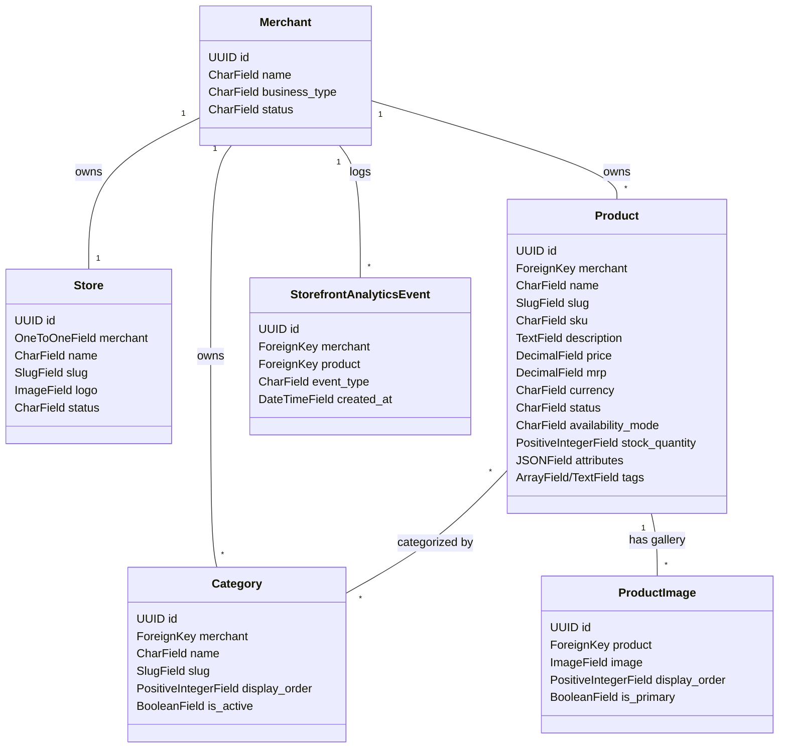

# Task 011 — Stitch Design Audit & UI-to-Domain Mapping

**Project**: MyCatalogue — Digital Storefront SaaS  
**Stitch Project Title**: MyCatalogue Digital Storefront SaaS  
**Stitch Project ID**: `6403466717281225322`  
**Date**: November 18, 2026  
**Status**: Pre-Implementation Audit & Planning (NO CODE MODIFICATIONS)

---

## Executive Summary

This audit document evaluates the approved Google Stitch UI designs for **MyCatalogue** against the current Django 5.1 modular monolith codebase. All four Stitch screens (including HTML specifications and high-resolution rendered design assets) were retrieved via the Stitch integration and analyzed down to individual UI components, form inputs, database fields, domain services, and HTMX interaction boundaries.

### Audited Stitch Screens Summary
1. **Screen 1**: `Product Management - Inventory` (ID: `e2b03c6cee4a4f09ab4b8afa1d2c627d`) — Desktop 2560x2532
2. **Screen 2**: `Merchant Digital Catalog Dashboard (Prototype V2)` (ID: `82d448eaee424ff9a06490a4b3c7fc1b`) — Desktop 1280x1024 (Structural precursor to Screen 4)
3. **Screen 3**: `Create Product & Custom Attributes` (ID: `55d9610f0ae047f4bd8071e71181e22f`) — Desktop 2560x4360
4. **Screen 4**: `Merchant Overview Dashboard` (ID: `45cc2392a8e34db2b98061caffdfc2fa`) — Desktop 2560x3676

---

## 1. Screen-by-Screen Breakdown

### 1.1 Screen 1 — Product Management - Inventory (`e2b03c6cee4a4f09ab4b8afa1d2c627d`)

A high-density operational workbench designed for merchant catalogue managers. Combines deep inventory controls, real-time storefront synchronization, advanced multi-facet filtering, contextual bulk operations, and high-visibility status badges.

#### Key Sections:
1. **Top Application Bar**:
   - Platform branding (`MyCatalogue`).
   - Active Merchant badge with business category and one-click store URL copy trigger (`Krishna Garments - Retail & E-commerce`).
   - Direct storefront launch anchor (`View Live Storefront` with external link icon).
   - Operational notifications bell with unread indicator dot and contextual Help shortcut.
   - User profile identity pill (`Rajesh Sharma - Owner`).
2. **Left Navigation Sidebar**:
   - `Catalog Operations` section:
     - Overview (Dashboard entry).
     - Products (`184` total active products badge).
     - Categories (`6` categories badge).
     - Store Settings (URL, branding, domain).
   - `Growth Modules` section:
     - QR & Sharing (`SOON` badge).
     - Customer Feedback (`BETA` badge).
     - Basic Analytics (`SOON` badge).
   - Bottom Utility tray:
     - Subscription Plan card (`Free Merchant Tier - Active`, `Upgrade to Pro ->`).
     - WhatsApp Support direct action.
     - Collapsible sidebar toggle button.
3. **Operational Notification Banner**:
   - Informational alert on Storefront Sync Optimization: highlights that Draft or Out-of-Stock items update public storefront visibility rules automatically.
   - Dismiss and `Catalog Rules` shortcut triggers.
4. **Header Section & Action Deck**:
   - Page title (`Products`), live catalogue badge with pulsing dot, and item counter.
   - Action buttons: `Export CSV / Backup`, `Bulk Upload`, and primary `+ Add Product` button.
5. **Multi-facet Filter & Search Toolbar**:
   - Full-text search input with SKU, name, and tag awareness.
   - Category dropdown filter with per-category item counts (e.g. `Men's Wear (68)`).
   - Publishing Status filter dropdown (`All Statuses (184)`, `Published (168)`, `Draft (9)`, `Archived (7)`).
   - Availability filter dropdown (`All Availability`, `In Stock (162)`, `Out of Stock (15)`, `Made to Order (7)`).
   - Price range popover trigger (`Price (₹)`).
   - Clear all active filters quick button.
6. **Active Filters Feedback Row**:
   - Visual chip list of active filters with individual remove (`x`) buttons (e.g. `Category: Men's Wear`, `Stock: All`).
   - Quick `Reset Filters` link.
   - Result count telemetry (`Showing 68 of 184 items`).
7. **Bulk Action Quick Tray (Contextual)**:
   - Hidden by default; surfaces dynamically when rows are selected (`2 Products Selected`).
   - Bulk triggers: `Bulk Publish`, `Change Category`, `Archive Selected`, `Close`.
8. **Product Management Data Table**:
   - 9 columns:
     1. Multi-select Checkbox (`select-all`).
     2. Product & Spec (Thumbnail 56x56, product title, spec subtitle e.g. `100% Combed Cotton • Regular Fit`).
     3. SKU / Code (Monospace SKU + secondary EAN/Barcode e.g. `EAN: 8901234401`).
     4. Category (Badge pill e.g. `Men's Wear`).
     5. Price (INR) (Prominent selling price e.g. `₹300` + strikethrough MRP e.g. `MRP ₹499` or `Net Price`).
     6. Availability (Status pill e.g. `In Stock (42)`, `Out of Stock`, `Made to Order (7)`).
     7. Storefront status (`Published`, `Draft`, `Archived`).
     8. Last Updated (Relative timestamp e.g. `Today, 11:30 AM`, `Yesterday`, `Oct 24, 2024`).
     9. Actions (`View on storefront`, `Quick Edit`, `More options` menu).
9. **Table Pagination & Page Size Toolbar**:
   - Selection state text (`Selected 0 of 184 items • Showing 1 to 7 of 184 items`).
   - Page size dropdown selector (`Rows: 25`).
   - Numeric pagination navigation (`< 1 2 3 ... 26 >`).
10. **Bottom Operational Metric Cards**:
    - `Storefront Coverage`: `91.3%` (`168 published products ready to sell`).
    - `Stock Replenishment Urgency`: `15 SKUs` (`Currently out of stock on your storefront`).
    - `WhatsApp Catalog Status`: `Connected` (`Synced with Krishna Garments Business API`).

---

### 1.2 Screen 3 — Create Product & Custom Attributes (`55d9610f0ae047f4bd8071e71181e22f`)

A comprehensive merchant product creation and editing interface supporting structured custom attributes, multi-photo gallery management, pricing rules, stock modes, and live WhatsApp catalogue previews.

#### Key Sections:
1. **Header & Context Bar**:
   - Breadcrumb navigation (`Products / Add New Product`).
   - Title with dynamic SKU badge (`Add New Product - SKU #185`).
   - Action controls: `Cancel`, `Save as Draft`, `Preview Storefront`, `Publish to Storefront`.
2. **Left Column (Product Core & Attributes)**:
   - **Basic Information Card (`CORE SKU` badge)**:
     - `Product Title *` (input with `Max 90 chars` counter).
     - `Storefront Public URL` (live preview with regeneration button: `mycatalogue.com/s/krishnagarments/p/classic-cotton-tshirt`).
     - Two-column row:
       - `SKU / Article Code (Optional)` (`# TSH-COT-001`).
       - `Category *` (dropdown with inline modal trigger `+ Create New`).
     - `Product Description`:
       - Formatting toolbar (Bold, Italic, Bulleted List, Numbered List, Table).
       - Status indicator (`Auto-saved draft`).
       - Multiline textarea.
   - **Product Photography & Gallery Card (`3 of 8 uploaded` badge)**:
     - Drag-and-drop file upload zone (JPG, PNG, WebP up to 10MB; 4:5 portrait aspect ratio guidance).
     - Visual grid of 8 image slots:
       - Slot 1 (`Primary` badge).
       - Slot 2, Slot 3.
       - Slots 4 to 8 placeholder (`+ Add More Images Slot 4 to 8`).
     - Indian Retailer Pro Tip alert (photographs in natural daylight increase WhatsApp conversions by 40%).
   - **Custom Product Attributes Card (`5 Attributes` badge)**:
     - Section subtext explaining customer filtering on storefront.
     - Attribute builder matrix:
       - Column headers: `LABEL`, `FIELD TYPE`, `VALUE / VALUES / SWATCHES`, `STOREFRONT`, `FILTER`, `ACTIONS`.
       - Row 1: `Fabric` (Single Select -> `100% Pure Cotton`, Storefront: Yes, Filter: Yes).
       - Row 2: `Available Sizes` (Multi-select Chips -> `S`, `M`, `L`, `XL`, `XXL`, Storefront: Yes, Filter: Yes).
       - Row 3: `Available Colours` (Colour Picker / Swatches -> `Navy`, `Olive`, `White`, `Charcoal`, Storefront: Yes, Filter: No).
       - Row 4: `Fit` (Single Select -> `Regular Fit`, Storefront: Yes, Filter: No).
       - Row 5: `Care Instructions` (Free Text -> `Machine wash cold`, Storefront: Yes, Filter: No).
     - Action button: `+ Add Custom Specification`.
     - Preset types hint: `Text | Number | Single Select | Multi-select | Colour`.
3. **Right Column (Commercial & Storefront Settings)**:
   - **Pricing & Margins Card (`INR (₹)` pill)**:
     - `Selling Price *` (prominent input: `₹ 300`).
     - `MRP / Original Price` (input: `₹ 499`) with auto-calculated discount pill (`40% OFF`).
     - Computed merchant savings display (`Merchant Savings Display: Save ₹199`).
     - Checkbox: `Hide price on storefront`.
     - Checkbox: `Show as "Contact for Price"` (for wholesale / bulk queries).
   - **Availability & Stock Card (Live status dot)**:
     - Radio group:
       1. `Available & In Stock` (`Ready for immediate pickup or courier delivery`).
       2. `Made to Order / On Demand` (`Tailoring, customized sizing, 3-5 days dispatch`).
       3. `Out of Stock` (`Visible in catalog with 'Notify Me' button`).
     - Stock count field: `Track inventory count: 142 units in mandi rack`.
   - **Storefront & Social Card**:
     - `Publish Immediately` toggle switch.
     - `Search & Filter Tags`: interactive chips (`Cotton [x]`, `Summer [x]`, `Casual [x]`, `Dailywear [x]`, `+ Add tag`).
     - `WhatsApp Share Preview` card:
       - Visual card simulation showing how the product snippet appears when shared in WhatsApp chats.
       - Badges: `Includes WhatsApp Buy button`, `Ready`.
   - Bottom Primary Action:
     - `Publish to Storefront` (Full-width indigo action button).

---

### 1.3 Screen 4 (and Screen 2) — Merchant Overview Dashboard (`45cc2392a8e34db2b98061caffdfc2fa`)

The primary executive dashboard for merchant owners. Unifies live digital storefront discovery signals, catalogue operational health KPIs, recent catalogue updates, and physical-to-digital QR growth tools.

#### Key Sections:
1. **Executive Hero Card**:
   - Account health status badge: `Storefront Live & Discoverable`.
   - Unique Store Identifier: `STORE ID: KG-DEL-409`.
   - Personal cultural greeting: `Namaste, Rajesh Sharma!`.
   - Operational context: `Here is what is happening at Krishna Garments today. Your digital catalogue is synced with Chandni Chowk store ledger.`.
   - Live Storefront URL widget with `Copy Link` and `View Live Store` buttons.
   - Quick Action bar: `+ Add New Product`, `Share on WhatsApp`, `QR Poster`, `Categories`.
2. **Catalog Operations Summary Grid (5 KPIs)**:
   - `Total Products`: `184` (`^ +12 this mo.`, Target: 220 for Festive Season).
   - `Published & In Stock`: `168` (`91.3% live`, Ready for immediate checkout).
   - `Drafts / Incomplete`: `9` (`Action req.`, Missing photos or fabric specs).
   - `Stock Alerts`: `7` (`4 OOS • 3 MTO`, Replenish silk & denim lines).
   - `Total Categories`: `6` (`Departments`, Preview tags: Men's, Women's, Festive, +3 more).
3. **Storefront Discovery & Shopper Intent (Telemetry Deck)**:
   - Header badge: `LIVE SIGNALS (30D)`, Period filter: `Last 30 Days`.
   - 4 Shopper Engagement Metrics:
     1. `Storefront Visits`: `2,840` (`+24.8% vs last month`, Direct QR & WhatsApp link taps).
     2. `Product Page Views`: `9,120` (`3.2 views / visitor avg`, Highest in Festive Silk Kurta line).
     3. `Shopper Favourites`: `418` (In shopper wishlists, Strong repeat conversion intent).
     4. `WhatsApp Inquiries`: `94 clicks` (Direct customer chats, Instant size & bulk rate queries).
4. **Recently Updated Products Grid (Left Column)**:
   - Header with counter (`5 items shown`) and `View All (184) ->` link.
   - Table showing 5 latest items: Product thumbnail/title/SKU, Category, Price & Margin (e.g. ₹300 MRP ₹499), Status pill (e.g. `Published / In Stock`, `Draft (Incomplete) / Out of Stock`).
   - Operational footer: Sync interval note, `Bulk Export CSV` and `Quick Price Edit` buttons.
5. **Physical-to-Digital Growth Deck (Right Column)**:
   - **Card 1: Storefront QR Code (`High Res` badge)**:
     - Retail use case description (place on counter, bills, bags).
     - Rendered vector QR code with merchant initials/logo in center (`KG`).
     - Actions: `Print A4 Counter Poster` and `Download PNG / SVG`.
   - **Card 2: Merchant Growth Tip (WhatsApp Status Boost)**:
     - Practical retail marketing guidance to drive 3x local WhatsApp inquiries.
     - Pre-composed Hinglish promotional copy with one-click `Copy Text` icon.
     - Direct CTA: `Post Directly to WhatsApp Status` (`api.whatsapp.com/send`).

---

## 2. Component Inventory

| Component Name | Stitch Screen(s) | UI Type | Existing in Codebase? | Implementation Required |
|---|---|---|---|---|
| **Platform Header** | All | Global Navigation | Partial (`dashboard_base.html`) | Add notifications, help icon, store link copy, user avatar |
| **Merchant Workspace Sidebar** | All | Global Navigation | Partial (`dashboard_base.html`) | Add module badges (`SOON`, `BETA`), plan card, WhatsApp help |
| **Operational Sync Banner** | Screen 1 | Alert / Notice | No (only Django messages) | Persistent/dismissible banner partial |
| **Catalogue Header & Actions** | Screen 1 | Page Header | Partial (`list.html`) | Add `Live Catalog` pulsing badge, CSV export, Bulk upload |
| **Multi-facet Filter Bar** | Screen 1 | Filter Toolbar | Partial (`list.html`) | Add category counts, multi-state availability, price popover |
| **Active Filters Chip Row** | Screen 1 | Filter Feedback | Partial (simple Reset link) | Add removable filter tag chips with HTMX triggers |
| **Bulk Action Quick Tray** | Screen 1 | Contextual Toolbar | No | Checkbox selection JS + HTMX bulk action endpoints |
| **Inventory Table** | Screen 1 | Data Table | Partial (`product_table.html`) | Add checkboxes, EAN, MRP, stock mode, last updated |
| **Numeric Pagination Deck** | Screen 1 | Pagination Nav | Partial (`product_table.html`) | Add rows-per-page selector and numbered pagination buttons |
| **Inventory Metric Cards** | Screen 1 | KPI Stat Cards | Partial (in overview only) | Embed coverage, out-of-stock, and WhatsApp status cards |
| **Product Form Header** | Screen 3 | Page Header | Partial (`form.html`) | Add next SKU badge, Save as Draft, Preview triggers |
| **Basic Information Card** | Screen 3 | Form Section | Yes (`form.html`) | Add char counter, auto-slug refresh, inline category modal |
| **Markdown / Rich Description** | Screen 3 | Form Input | Partial (plain textarea) | Add toolbar (bold, list, table) and auto-save indicator |
| **8-Slot Photo Gallery** | Screen 3 | Media Upload | Partial (`form.html`) | Add 8 structured slots, aspect ratio guide, Indian retailer tip |
| **Custom Attribute Matrix** | Screen 3 | Dynamic Form | Partial (key-value JSON) | Multi-type matrix (select, chips, swatches, storefront/filter flags) |
| **Pricing & Margin Card** | Screen 3 | Form Section | Partial (`form.html`) | Add MRP, discount %, savings display, hide price checkbox |
| **Availability & Stock Card** | Screen 3 | Form Section | Partial (`is_available` bool) | Add 3-state radio (In Stock, Made to Order, OOS) + stock count |
| **Storefront & Social Card** | Screen 3 | Form Section | Partial (`status` choice) | Add tags input and live WhatsApp chat share preview card |
| **Dashboard Hero Card** | Screen 4 | Executive Card | Partial (`dashboard_overview.html`) | Add Store ID, greeting, URL widget, quick action buttons |
| **Catalog Operations KPIs** | Screen 4 | 5-KPI Grid | Partial (`products/overview.html`) | Add monthly delta, live %, stock alert breakdown, tag chips |
| **Shopper Intent Telemetry** | Screen 4 | 4-KPI Grid | No | Storefront analytics model, visit tracking, period selector |
| **Recent Products Table** | Screen 4 | Data Table | Partial (`products/overview.html`) | Add MRP/margin column, quick price edit, export CSV |
| **Storefront QR Generator** | Screen 4 | Media / Growth Card | No | QR code generation service, A4 printable poster view |
| **WhatsApp Growth Tip Card** | Screen 4 | Marketing Card | No | Pre-filled copy box with one-click copy and WhatsApp intent link |

---

## 3. Django Domain Mapping



### 3.1 Mapping Matrix by Domain App

| Stitch Component | Django App | Model & Field(s) | Selector / Query | Domain Service | View & Template |
|---|---|---|---|---|---|
| **Storefront URL & Live Status** | `apps.stores` | `Store.slug`, `Store.status`, `Store.is_publicly_accessible` | `get_merchant_store(merchant)` | `publish_store()`, `unpublish_store()` | `merchants:dashboard` -> `dashboard_overview.html` |
| **Store Identifier (KG-DEL-409)** | `apps.stores` or `apps.merchants` | `Merchant.id` or new `Store.store_code` | `merchant.store` | None (derived or formatted) | `templates/merchants/dashboard_overview.html` |
| **Catalog Operations KPIs** | `apps.products` | `Product.status`, `Product.is_available`, `Category.is_active` | `get_catalogue_summary(merchant)` | None (read selector) | `products:overview` -> `products/overview.html` |
| **Shopper Telemetry (Visits/Views)** | `apps.analytics` (Proposed) | New `StorefrontAnalyticsEvent` (`event_type`, `merchant`, `product`) | Proposed: `get_storefront_telemetry(merchant, days=30)` | Proposed: `record_storefront_event()` | `merchants:dashboard` -> `dashboard_overview.html` |
| **Inventory Table Rows** | `apps.products` | `Product`, `ProductImage`, `Category` | `get_merchant_products(merchant, ...)` | `publish_product()`, `archive_product()` | `products:product_list` -> `product_table.html` |
| **Product Search & Filtering** | `apps.products` | `Product.name`, `Product.sku`, `Product.categories`, `Product.status` | `get_merchant_products(..., search_query, category, status)` | None (filtering) | `ProductListView` -> `product_table.html` (HTMX) |
| **Bulk Product Mutations** | `apps.products` | `Product.status`, `Product.categories` | `Product.objects.filter(merchant=merchant, id__in=pks)` | Proposed: `bulk_publish_products()`, `bulk_archive_products()` | Proposed: `ProductBulkActionView` |
| **Product Create / Edit Form** | `apps.products` | `Product.*`, `ProductImage`, `ProductCategory` | `get_product_for_merchant(id, merchant)` | `create_product()`, `update_product_profile()` | `ProductCreateView` / `ProductEditView` -> `form.html` |
| **Custom Attribute Specifications** | `apps.products` | `Product.attributes` (JSONField) | `product.attributes` | `validate_attributes()`, `update_product_profile()` | `products/partials/attribute_matrix.html` |
| **Storefront QR Code & Poster** | `apps.stores` | `Store.slug`, `Store.name` | `merchant.store` | Proposed: `generate_store_qr_code(store)` | Proposed: `StoreQRPDFView`, `StoreQRImageView` |
| **WhatsApp Share & Catalog** | `apps.products` | `Product.name`, `Product.price`, `Store.slug` | `get_product_for_merchant()` | Proposed: `build_whatsapp_product_link()` | `products/partials/whatsapp_preview.html` |

---

## 4. Existing vs. Missing Data

### 4.1 Product Domain (`apps.products`)

| Field / Feature in Stitch | Existing Django Model Field | Status | Architectural Resolution |
|---|---|---|---|
| **Product Title** | `Product.name` (`CharField(255)`) | **Exists** | Fully supported. |
| **Product Slug** | `Product.slug` (`SlugField(255)`) | **Exists** | Fully supported with merchant-scoped uniqueness. |
| **SKU / Article Code** | `Product.sku` (`CharField(100)`) | **Exists** | Fully supported with merchant-scoped uniqueness constraint. |
| **Description** | `Product.description` (`TextField`) | **Exists** | Fully supported. Rich text/markdown toolbar is pure presentation. |
| **Selling Price** | `Product.price` (`DecimalField(12, 2)`) | **Exists** | Fully supported. Null = Contact for Price. |
| **Currency** | `Product.currency` (`CharField(3)`) | **Exists** | Default `INR (₹)` supported. |
| **MRP / Original Price** | None | **Missing** | Add `mrp = models.DecimalField(max_digits=12, decimal_places=2, null=True, blank=True)`. Used for strike-through and discount calculation. |
| **Hide Price Flag** | None | **Missing** | Handled either by leaving `price=None` OR adding explicit `is_price_hidden = models.BooleanField(default=False)`. |
| **Availability Mode** | `Product.is_available` (`BooleanField`) | **Partial** | Stitch shows 3 modes: `IN_STOCK`, `MADE_TO_ORDER`, `OUT_OF_STOCK`. Currently only binary boolean exists. |
| **Inventory Quantity** | None | **Missing** | Add `stock_quantity = models.PositiveIntegerField(null=True, blank=True)`. |
| **Barcode / EAN** | None | **Missing** | Add `barcode = models.CharField(max_length=50, blank=True, null=True)` or store within `attributes` JSON. |
| **Search / Filter Tags** | None | **Missing** | Add `tags = models.CharField(max_length=255, blank=True, default="")` (comma-separated) or store in `attributes`. |
| **Custom Attributes Structure** | `Product.attributes` (`JSONField`) | **Exists (Raw)** | Model has `JSONField`. Needs schema specification for `label`, `type`, `values`, `is_storefront`, `is_filter`. |
| **Primary Image & Gallery** | `ProductImage` (`is_primary`, `image`, `order`) | **Exists** | Fully supported by existing `ProductImage` model up to 8 images. |
| **Publishing Status** | `Product.status` (`PUBLISHED`, `DRAFT`, `ARCHIVED`) | **Exists** | Matches Stitch statuses exactly. |

### 4.2 Merchant & Store Domain (`apps.merchants`, `apps.stores`)

| Field / Feature in Stitch | Existing Django Model Field | Status | Architectural Resolution |
|---|---|---|---|
| **Store Name** | `Store.name` | **Exists** | Supported. |
| **Store Public URL** | `Store.slug` -> `/s/<slug>/` | **Exists** | Supported. |
| **Store ID (e.g. `KG-DEL-409`)** | None | **Missing** | Either format from `merchant.id` (e.g. `KG-${id[:6]}`) or add `store_code` on `Store`. |
| **Owner Name** | `User.first_name` / `User.email` | **Exists** | Supported via `request.user`. |
| **WhatsApp Support Action** | Merchant phone number | **Exists** | Formatted via `https://wa.me/<number>`. |
| **Storefront QR Code** | None | **Missing** | Generate dynamically from `store.get_absolute_url()` via `qrcode` library in-memory (no storage migration needed). |

### 4.3 Analytics & Growth Telemetry (New Domain)

| Field / Feature in Stitch | Existing Django Model Field | Status | Architectural Resolution |
|---|---|---|---|
| **Storefront Visits (30D)** | None | **Missing** | Requires new `apps.analytics` app or lightweight event log table. |
| **Product Page Views (30D)** | None | **Missing** | Requires page view tracking on `/s/<store_slug>/p/<product_slug>/`. |
| **WhatsApp Inquiries Clicks** | None | **Missing** | Requires tracking redirect/endpoint on WhatsApp buy button clicks. |
| **Shopper Favourites / Wishlists** | None | **Missing** | Shopper wishlist tracking requires customer session/cookie store. |

---

## 5. Proposed Model Changes (For Future Tasks — NOT APPLIED IN TASK 011)

> [!IMPORTANT]
> In accordance with Task 011 restrictions, **zero schema changes or migrations are applied during this task**. The following schema design is documented for human architectural review prior to Task 012.

### 5.1 Proposed Changes to `apps.products.models.Product`

```python
# Proposed additions to Product model in future task:
class AvailabilityMode(models.TextChoices):
    IN_STOCK = "IN_STOCK", _("Available & In Stock")
    MADE_TO_ORDER = "MADE_TO_ORDER", _("Made to Order / On Demand")
    OUT_OF_STOCK = "OUT_OF_STOCK", _("Out of Stock")

# Fields to add:
mrp = models.DecimalField(
    _("MRP / compare-at price"),
    max_digits=12,
    decimal_places=2,
    null=True,
    blank=True,
    validators=[MinValueValidator(Decimal("0.00"))],
    help_text=_("Original price for strike-through display and discount calculation."),
)
availability_mode = models.CharField(
    _("availability mode"),
    max_length=20,
    choices=AvailabilityMode.choices,
    default=AvailabilityMode.IN_STOCK,
    db_index=True,
)
stock_quantity = models.PositiveIntegerField(
    _("stock quantity"),
    null=True,
    blank=True,
    help_text=_("Optional inventory count for stock tracking."),
)
barcode = models.CharField(
    _("barcode / EAN"),
    max_length=50,
    blank=True,
    null=True,
    db_index=True,
)
tags = models.CharField(
    _("search tags"),
    max_length=255,
    blank=True,
    default="",
    help_text=_("Comma-separated tags for storefront search and filtering."),
)
is_price_hidden = models.BooleanField(
    _("hide price on storefront"),
    default=False,
    help_text=_("If True, displays 'Contact for Price' regardless of numeric price."),
)
```

#### Migration & Integrity Impact:
- All proposed fields are `null=True` or have safe defaults (`default=""`, `default=False`, `default=IN_STOCK`).
- **Zero data loss risk** on existing records. Existing `is_available=True` maps seamlessly to `availability_mode="IN_STOCK"`.
- Backward compatibility: `is_available` can remain as a computed property returning `availability_mode != AvailabilityMode.OUT_OF_STOCK`.

### 5.2 Structured Attribute Schema for `Product.attributes` JSONField

Rather than creating separate relational tables for attributes, the existing `Product.attributes` `JSONField` can store the rich Stitch attribute specification cleanly:

```json
{
  "specifications": [
    {
      "key": "fabric",
      "label": "Fabric",
      "type": "single_select",
      "value": "100% Pure Cotton",
      "show_on_storefront": true,
      "is_filter": true
    },
    {
      "key": "sizes",
      "label": "Available Sizes",
      "type": "multi_select",
      "values": ["S", "M", "L", "XL", "XXL"],
      "show_on_storefront": true,
      "is_filter": true
    },
    {
      "key": "colours",
      "label": "Available Colours",
      "type": "color_picker",
      "values": [
        {"name": "Navy", "hex": "#1b2a4a"},
        {"name": "Olive", "hex": "#556b2f"},
        {"name": "White", "hex": "#ffffff"}
      ],
      "show_on_storefront": true,
      "is_filter": false
    }
  ]
}
```

---

## 6. Proposed URLs and Views

### 6.1 Product & Catalogue Management (`apps.products.urls`)

| URL Pattern | View Class | Method(s) | Purpose |
|---|---|---|---|
| `/merchants/products/` | `CatalogueOverviewView` | GET | Operational dashboard with 5 KPI cards, recent products |
| `/merchants/products/items/` | `ProductListView` | GET | Inventory table with multi-facet filters & pagination |
| `/merchants/products/items/bulk/` | `ProductBulkActionView` *(New)* | POST | Bulk publish, bulk archive, bulk category reassignment |
| `/merchants/products/items/export/` | `ProductExportCSVView` *(New)* | GET | Exports merchant's products to CSV formatted for backup |
| `/merchants/products/items/new/` | `ProductCreateView` | GET, POST | Product creation form with gallery & attribute builder |
| `/merchants/products/items/<uuid>/edit/` | `ProductEditView` | GET, POST | Product editing form |
| `/merchants/products/items/<uuid>/quick-price/` | `ProductQuickPriceView` *(New)* | POST | Inline HTMX quick price & MRP editor |
| `/merchants/products/items/<uuid>/preview/` | `ProductStorefrontPreviewView` *(New)* | GET | Render draft product in public storefront layout |

### 6.2 Merchant Dashboard & Growth Tools (`apps.merchants.urls`, `apps.stores.urls`)

| URL Pattern | View Class | Method(s) | Purpose |
|---|---|---|---|
| `/merchants/dashboard/` | `MerchantDashboardView` | GET | Main executive dashboard (Screen 4) |
| `/merchants/store/qr/image/` | `StoreQRDownloadView` *(New)* | GET | Dynamic PNG/SVG QR code download for counter/packaging |
| `/merchants/store/qr/poster/` | `StoreQRPrintPosterView` *(New)* | GET | Printable A4 counter poster template view |

---

## 7. Template Structure & HTMX Interactions

### 7.1 Proposed Template Architecture

```
templates/
├── merchants/
│   ├── dashboard_base.html                  <-- Global shell (header, sidebar, drawer)
│   ├── dashboard_overview.html              <-- Screen 4: Executive dashboard
│   └── partials/
│       ├── metric_card.html                 <-- Reusable KPI stat card
│       ├── qr_code_card.html                <-- Printable QR card & actions
│       └── whatsapp_status_boost.html       <-- Hinglish copy & WhatsApp intent
├── products/
│   ├── overview.html                        <-- Screen 1 bottom overview / metrics
│   ├── list.html                            <-- Screen 1: Inventory management
│   ├── form.html                            <-- Screen 3: Add / Edit product
│   └── partials/
│       ├── product_table.html               <-- HTMX table target & pagination
│       ├── bulk_action_tray.html            <-- Floating selection bar
│       ├── active_filter_chips.html         <-- Removable filter tags
│       ├── image_gallery_slots.html         <-- 8-slot photo grid
│       ├── attribute_matrix.html            <-- Multi-type attribute builder
│       ├── pricing_margins_card.html        <-- Price, MRP, and discount calculator
│       └── whatsapp_share_preview.html      <-- Live WhatsApp message card preview
```

### 7.2 HTMX Interaction Specifications

1. **Inventory Table Search & Multi-facet Filter**:
   - `hx-get=""`
   - `hx-target="#products-table-container"`
   - `hx-swap="outerHTML"`
   - `hx-push-url="true"`
   - `hx-trigger="submit, change from:select, keyup changed delay:300ms from:#search-input"`
   - **Out-of-Band Swaps**:
     - `#product-count-badge`: header count pill.
     - `#active-filter-chips-container`: dynamic tag chips.
2. **Inline Slug Availability Check**:
   - `hx-post=""`
   - `hx-trigger="keyup changed delay:400ms from:#id_slug"`
   - `hx-target="#slug-feedback"`
   - `hx-swap="innerHTML"`
3. **Dynamic Custom Attribute Row Insertion**:
   - `hx-get="?type=single_select"`
   - `hx-target="#attributes-table-body"`
   - `hx-swap="beforeend"`
4. **Contextual Bulk Action Quick Tray**:
   - Triggered via vanilla JS on table checkbox toggle; sends selected IDs via `hx-post=""`.

---

## 8. Interaction and Validation Requirements

1. **MRP & Pricing Invariant**:
   - If `mrp` is provided, `mrp >= price` must be validated. A selling price higher than the original MRP should raise a validation error or warning.
   - Discount calculation formula: `((mrp - price) / mrp) * 100` displayed to the merchant in real-time.
2. **Image Slot Validation**:
   - Enforce maximum 8 gallery images per product.
   - Max file size: 10 MB per image.
   - Allowed formats: JPEG, PNG, WebP (validated via Pillow binary decoding).
   - Enforce strictly one primary thumbnail image (`is_primary=True`).
3. **Attribute Schema Validation**:
   - Ensure attribute keys are normalized (lowercase alphanumeric + underscores).
   - Ensure color hex values match valid regex `^#[0-9a-fA-F]{6}$`.
   - Prevent cross-tenant attribute pollution.
4. **Export CSV Sanitization**:
   - Escape spreadsheet formula injection characters (`=`, `+`, `-`, `@`) when generating CSV exports.

---

## 9. Security & Tenant-Isolation Considerations

1. **Merchant-Scoped Lookup Strictness**:
   - Every database query for products, categories, stores, and analytics must include `merchant=request.merchant`.
   - Never trust product UUIDs, category IDs, or merchant IDs supplied in request payloads or URL parameters.
2. **Actor Authorization Matrix**:
   - Enforce `MANAGE_CATALOGUE` permission on all catalogue mutations.
   - `OWNER`, `ADMIN`, `MANAGER` roles are permitted; `STAFF` is denied.
   - Prevent suspended or inactive merchants from performing catalogue mutations or publishing stores.
3. **Public Storefront Invariants**:
   - A product must only be visible on the public storefront if:
     1. Associated Store is `status=PUBLISHED`.
     2. Associated Merchant is `status=ACTIVE`.
     3. Product is `status=PUBLISHED`.
     4. Product is `is_available=True` (or `availability_mode != OUT_OF_STOCK`).
4. **CSRF & HTTP Method Hardening**:
   - All mutation actions (`publish`, `unpublish`, `archive`, `bulk_action`, `delete_image`) must strictly require `POST` with CSRF tokens. Never permit mutations over `GET`.

---

## 10. Open Architectural Decisions Requiring Human Approval

Before proceeding to implementation in subsequent tasks (e.g. Task 012), the human developer must review and decide on the following four architectural questions:

### Decision 1 — Multi-state Availability vs. Existing Boolean
- **Option A (Recommended)**: Migrate `Product.is_available` from `BooleanField` to `CharField(choices=AvailabilityMode.choices)` (`IN_STOCK`, `MADE_TO_ORDER`, `OUT_OF_STOCK`) with a backward-compatible boolean property `is_available`.
- **Option B**: Keep `Product.is_available` as a `BooleanField` and store `made_to_order` as a separate flag or inside `Product.attributes`.

### Decision 2 — Pricing & Discount Model Fields
- **Option A (Recommended)**: Add `mrp = models.DecimalField(null=True, blank=True)` and `is_price_hidden = models.BooleanField(default=False)` directly to `Product`.
- **Option B**: Keep `Product.price` alone and store MRP inside `Product.attributes` JSON to avoid database schema additions.

### Decision 3 — Shopper Telemetry & Analytics Scope
- **Option A**: Implement a lightweight event table (`apps.analytics.models.StorefrontEvent`) for visits, views, and WhatsApp clicks.
- **Option B**: Defer analytics telemetry to a dedicated future analytics milestone, and render the Overview telemetry cards with neutral zero-state / coming-soon notices.

### Decision 4 — QR Code Generation Method
- **Option A (Recommended)**: Generate vector/PNG QR codes dynamically in-memory via Python `qrcode` library on an endpoint (e.g. `/merchants/store/qr/`), avoiding static asset storage overhead.
- **Option B**: Store pre-generated QR code PNG files in object storage on Store model.

---

*(End of Audit Document)*

